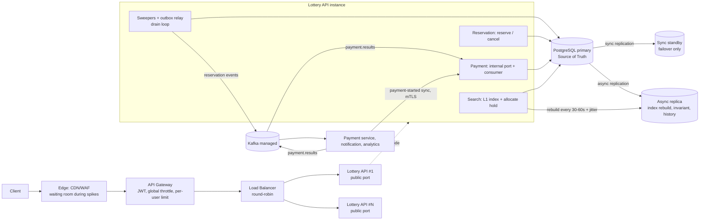
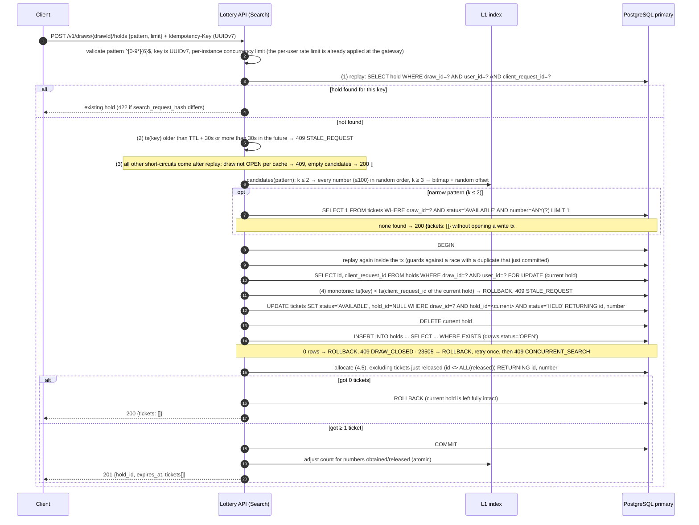
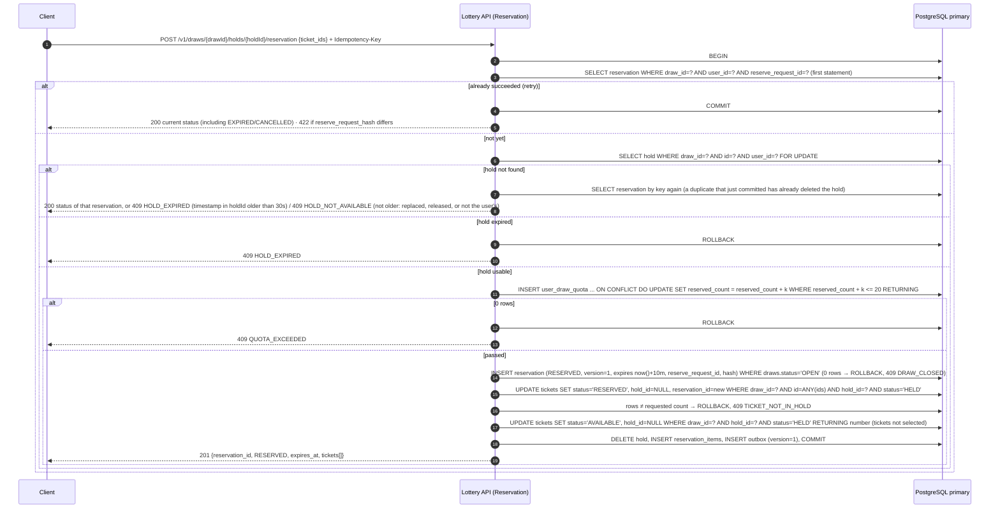
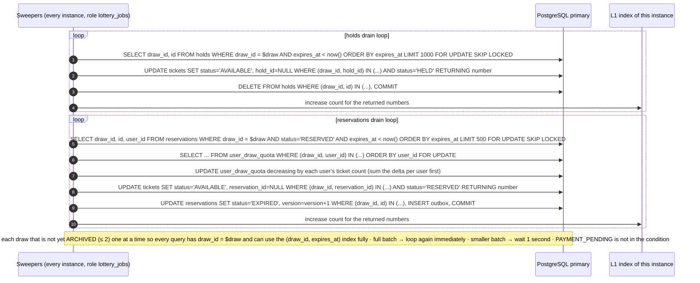
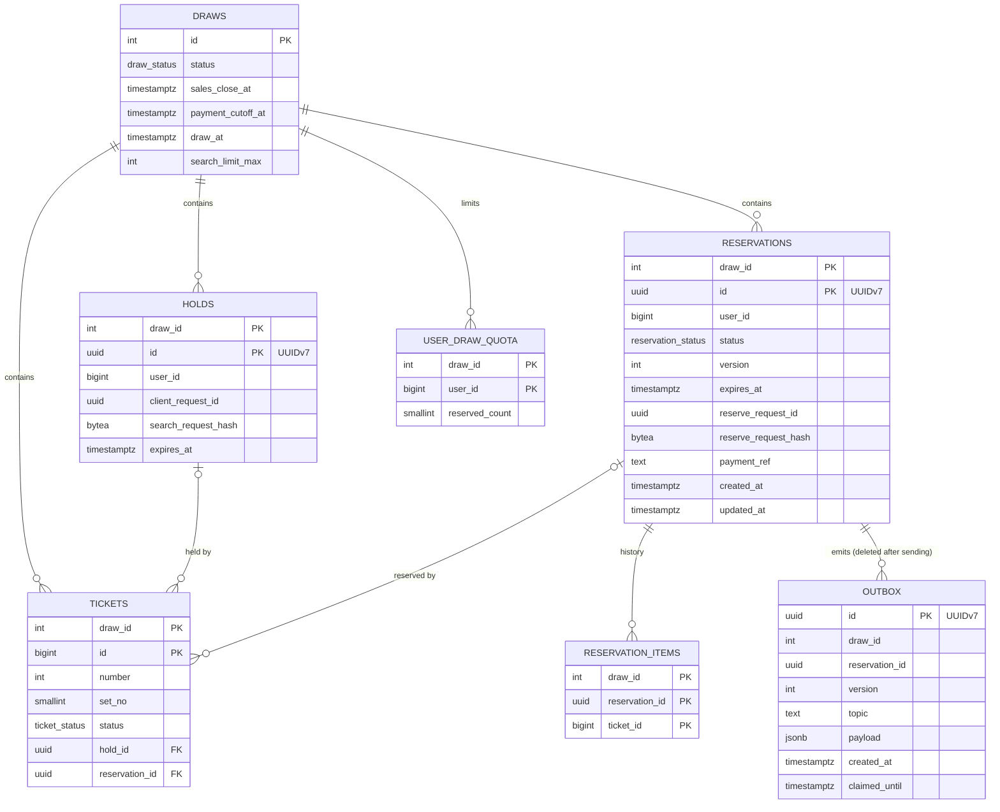
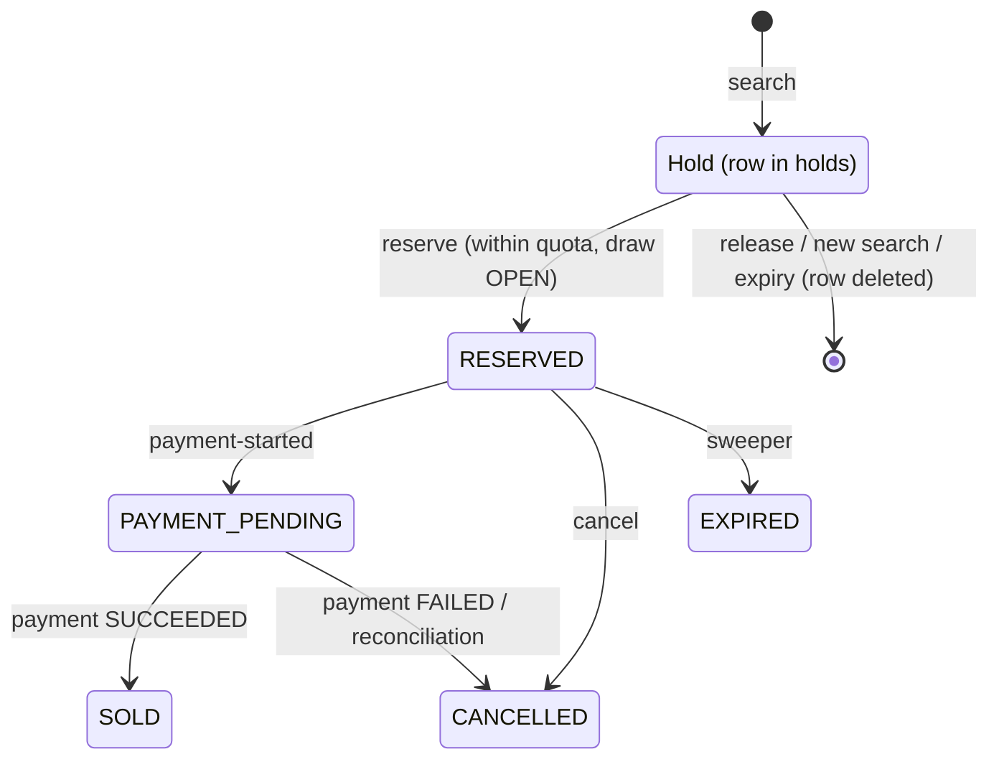
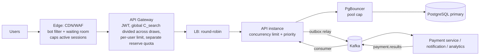

# Lottery Search System — Design Document

## Executive Summary

**PostgreSQL is the Source of Truth** for the state of every ticket, and an **in-memory Digit Bitmap Index (\~12 MB per instance)** in the API filters wildcards. Tickets are allocated with **`FOR UPDATE SKIP LOCKED`**, and every state change is a **conditional UPDATE** inside a single transaction.

The key observation behind the design: there are only 10^6 possible numbers (000000–999999) but 10M tickets, so the index covers the **number space (1M)**, not the **tickets (10M)**. Wildcard matching is pure arithmetic and does not rely on any database index.

The correctness path consists of only the Lottery API (stateless) and PostgreSQL (primary + sync standby + async replica). Everything around it is managed: the edge (CDN/WAF + waiting room) and the API Gateway apply load limits during spikes, and Kafka carries reservation events and payment results. There is no Redis and no search engine. A search result is a **hold** that lives for 30 seconds in the small `holds` table, separate from `reservations`, which stores only actual reservations.

Where the problem statement is silent, the design makes its own decisions, sized for a medium-to-worst-case load (Section 1, D1–D5). The decision with the greatest impact is D1: **a search is a soft-hold allocation**, which makes a search that finds tickets a write transaction. For the spike before the draw date, the system protects the database with several layers of load limiting at the API Gateway, and uses Kafka for async work, namely events and payment results (Section 12).

## 1. Requirements & Assumptions

The problem statement defines only four things clearly: 10M tickets, 6-digit numbers, 6-character patterns containing `*`, and the rule that the same ticket must not be handed to multiple users at the same time. Everything else in this section is an assumption and is labeled as such.

### Functional Requirements

1. **Exact search**, e.g. `123456`, and **Wildcard search** where `*` can be in any of the 6 positions (2^6 = 64 wildcard position layouts, and 11^6 ≈ 1.77M possible patterns). *(from the problem statement)*
2. Results show only tickets that can still be reserved. *(from the problem statement, interpreted from the distribution constraint)*
3. **Distribution:** users who search with the same pattern at the same time must receive different, non-overlapping sets of tickets. *(from the problem statement)*
4. Reserve, Get reservation, Cancel, automatic Reservation expiry, and hand-off to payment until the ticket is SOLD. *(assumption: the problem statement does not mention reservation, this comes from the design assignment's brief, see A6)*
5. A ticket can have at most 1 hold/reservation holder at any point in time, and a ticket that is SOLD must never be sold again. *(from the problem statement + assumption A6)*

### Non-functional Requirements

- **Correctness before performance:** double booking must be impossible, even with a stale cache or a service restart.
- **Search latency:** target p99 under 200 ms at the API layer (a self-imposed target, not a benchmark figure).
- **Scale out:** API instances can be added without changing the design.
- **Recoverable:** all important state lives in the DB, and a service restart must not corrupt data.

### Constraints

The problem statement does not specify team or schedule constraints. The values below are assumptions used to choose how complex the design should be.

| Constraint | Assumed value | Effect on design |
| --- | --- | --- |
| Team | 2–4 backend engineers who handle both development and operations | The correctness path is only API + PostgreSQL. API Gateway, the edge waiting room and Kafka are managed and outside the correctness path. There is a single index sync mechanism. |
| Language | Go (following Part 1 of the problem statement) | Bitmaps use `[]atomic.Uint64` + `math/bits`. The sweeper and rebuild are goroutines in the same process. |
| Database the team knows | Part 1 uses MongoDB | This part **deliberately chooses PostgreSQL**, because the core job is allocating N rows without overlap, and MongoDB has no `SKIP LOCKED` (Section 3, ADR-001). |
| Timeline | MVP within 1–2 months | Redis, sharding and splitting into separate services are future plans with defined triggers. |
| Infrastructure | Containers on a cloud with managed PostgreSQL (PostgreSQL 17 or later) and a gateway/LB that can route by header | Relies on the provider's HA. `transaction_timeout` requires PG17+. |

### Assumptions

| # | Assumption | Impact if untrue |
| --- | --- | --- |
| A1 | 1 ticket = (draw, number, set\_no). The same 6-digit number has multiple tickets (10M / 1M ≈ 10 tickets per number if evenly distributed). | If 1 number = 1 ticket, the real data is only 1M rows. The design still works and gets simpler. |
| A2 | Tickets of each draw are not added during the draw. At most 2 draws can be open at the same time (D5). The L1 index, rebuild and inventory are computed per draw, but the primary's capacity is a shared ceiling across all draws (12.1). | If tickets are added mid-draw, the index sees the new tickets in the next rebuild cycle. |
| A3 | The distribution of numbers may be uneven, and some numbers may have no tickets. | Correctness is unaffected, because the index is built from the real data. |
| A4 | One search returns at most N tickets (default 5, max 20), spread across different numbers when there are enough candidates. | If everything had to be returned, the pattern `******` would return 10M rows and holds would consume the entire inventory. |
| A5 | The distribution constraint is interpreted as search = **soft hold** with a **30 second** lifetime. A user can hold 1 set at a time per draw. | See D1 and the inventory impact in 8.3 (at an admitted \~2,800 searches/s that find tickets, \~420k tickets are held = 4.2%). |
| A6 | Payment is outside this system. The system receives payment-started through a synchronous internal API and receives payment results through Kafka (6.6). SOLD is a final state that no path can return a ticket from. | If refunded tickets must go back on sale, a separately approved transition has to be added. |
| A7 | The user is already authenticated, and the system gets `user_id` from the JWT. | — |
| A8 | One user can buy at most 20 tickets per draw (counting RESERVED, PAYMENT\_PENDING, SOLD). | Without the cap, a bot that stays under the rate limit can still sweep up inventory by reserving. |
| A9 | \~30% of searches find no tickets (popular numbers that are sold out, narrow patterns). | If it is higher, the read-only pre-check (Section 2) absorbs it without adding writes. |

## 2. High-Level Architecture

The correctness path has 2 parts: the Lottery API (stateless, multiple instances) and PostgreSQL (primary, sync standby, async replica). Everything around it is managed: the edge + API Gateway apply load limits during spikes, and Kafka carries events and payment results (Section 12). The sweeper, outbox relay and index rebuild run in the same binary as the API. The internal API for payment listens on a separate port that the public LB does not route to.



### Component Responsibilities

| Component | Responsibility | Why it exists |
| --- | --- | --- |
| Edge (CDN/WAF, managed) | Filters bots, opens the waiting room when search demand exceeds what the system can handle | Stops a spike from reaching the API at all (12.1) |
| API Gateway (managed) | Verifies the JWT, applies the global search throttle (`C_search`, divided across draws), applies a per-user limit from the JWT's `sub` using the gateway's own counter, and gives reserve/payment a separate quota | Protects the DB, and the per-user limit is accurate regardless of which instance a request lands on |
| Load Balancer | Round-robin, accepts traffic from the gateway only (network policy) | The API is stateless, so there is no need to route by user and no problem of unevenly hot instances |
| Search module | Validate, replay, find candidates from L1, pre-check, allocate hold | Takes the search work off the DB |
| Reservation module | Reserve, cancel, get, quota, write outbox | The write path that needs strong consistency |
| Sweepers + outbox relay | Return expired tickets, send events from the outbox to Kafka | PostgreSQL has no TTL, and events must not be lost once the DB has committed |
| Payment | payment-started (synchronous internal API) and the `payment.results` consumer | Defines the boundary of SOLD, and absorbs bursts of payment results without pressuring the DB |
| Kafka (managed) | `lottery.reservation-events`, `payment.results` | Durable buffer for async work, not in the reservation correctness path (12.2, ADR-005) |
| PostgreSQL primary | Stores tickets, holds, reservations, quota, outbox, and decides reservation outcomes | ACID and row-level locks |
| Sync standby | Failover target, serves no queries | No committed transaction is lost |
| Async replica | Rebuilds L1, invariant checks, history. `hot_standby_feedback = off` | Moves heavy reads off the primary without causing bloat on the primary (5.2) |

**User identity:** the API reads `user_id` from the forwarded JWT and verifies it itself, and uses this value to check ownership. The per-user limit lives at the gateway, which also reads `sub` from the verified JWT. No client-supplied header is used for any authorization decision or limit (the gateway always strips any internal header a client might forge).

**HS256 trade-off:** HS256 is used for consistency with Part 1 of the problem statement, but it is a shared secret: every component that can verify (the gateway and every API instance) can also **issue tokens** with that secret. The secret therefore has to live in a secret manager and be rotated on a schedule. If another service needs to verify tokens, or the API should not be able to issue tokens, switch to RS256 or EdDSA, which separate the private key (token issuer only) from the public key (verifiers).

Search and Reservation are in the same deployable in the first phase, because they write the same tables with the same transaction patterns. Splitting them now would add a network hop for no gain. The code is separated into modules, so they can be deployed separately later.

### Components Deliberately Left Out

- **Redis:** rebuilding L1 from the async replica is enough for a 12 MB index. A single-writer Redis is Phase 2 with a trigger (7.4), and Redis is never used as a lock or as the store of reservation state.
- **Kafka in the search/allocation path:** DB writes would not decrease and users would have to wait for an async result, so admission control + waiting room is used instead (12.4).
- **Elasticsearch / OpenSearch:** wildcards are solved with bitmaps (Section 4), and a search engine does not help with allocation.

### Lock Order (used on every path)

1. The `holds` or `reservations` row to be changed (for multiple rows, order by id or use `SKIP LOCKED`)
2. The `user_draw_quota` row, ordered by `user_id` with `SELECT ... ORDER BY user_id FOR UPDATE`
3. The `tickets` rows

Every transaction also retries automatically up to 3 times on `40P01` (deadlock) or `40001`, as a safety net and not as the main mechanism.

### Data Flow 1: Search (allocate hold)



**Important ordering:** the replay lookup must come before every "empty" answer. If the pre-check came first, a retry after a timeout from a user who just obtained the last 5 tickets of a popular number would get the answer "sold out", because all 5 tickets are HELD by that same user. The replay is a single-row point read through `UNIQUE (draw_id, user_id)`, so it can run outside the tx, and it is checked again inside the tx to close the race.

- **The pre-check** reads from the primary, because a wrong "none" result would be a wrong answer to the user. A race where a ticket appears after the pre-check is harmless.
- **Candidates for narrow patterns are shuffled**, so that everyone searching `**1234` does not start by colliding on 001234, and results are not biased toward low numbers.
- **Tickets just released from the old hold are excluded**, because a user who searches again wants a different set, and rows that the tx itself holds locks on are not skipped by SKIP LOCKED.
- **Getting 0 tickets** → `ROLLBACK` of the whole tx, so the user's current hold is not lost.
- **Both stale checks come after a replay miss.** A first request that was stuck in the network for a long time and has only now created a hold can still be replayed for the whole lifetime of the hold.
  - **Time window:** the ts in the key's UUIDv7 is older than hold lifetime + 30s, or more than 30s in the future → `409 STALE_REQUEST` (future timestamps are rejected too, otherwise a client with a fast clock would bypass the check entirely).
  - **Monotonic:** under the lock on the current hold, if ts(key) is older than ts(`client_request_id` of the current hold) → `409 STALE_REQUEST`. A late duplicate can therefore only release a hold older than itself, never a hold the user created later. No extra state is needed, because the current hold's key is already a UUIDv7.
  - **Trade-off:** a single user on multiple devices with widely differing clocks may get a 409, so clients should adjust their clock from the server's `Date` header before generating a key.

**Accepted trade-off (phantom hold):** if the old hold has already been reserved or released and the user has no current hold, a late duplicate that is still within the accepted time window will find no replay and will pass the monotonic check (there is no hold to compare against), so it creates a new hold the user did not ask for. The effect is limited to at most N tickets being set aside for ≤ 30 seconds, and it destroys no state of the user's. Closing this gap would require storing a watermark of the latest key in the `user_draw_quota` row, which adds 1 write to every search, so it is not done in the first phase.

### Data Flow 2: Reserve (hold → reservation)



Concurrent duplicate reserve requests wait on the row lock of the hold. Once the first one commits, the hold is deleted, so the second no longer finds the hold, SELECTs the reservation by key again, and gets the first request's result.

### Data Flow 3: Cancel and Release

`DELETE /v1/draws/{drawId}/reservations/{id}` → one tx: lock that user's reservation (AND user\_id = \<JWT sub>, not the user's own → 404) (`FOR UPDATE`) → lock the user's quota → branch on status

- **RESERVED and not yet expired:** tickets `WHERE draw_id = ? AND reservation_id = ? AND status = 'RESERVED'` go back to AVAILABLE, quota is decremented, and the reservation becomes CANCELLED (version + 1 and an outbox row is written) → `200`
- **RESERVED but past `expires_at` (the sweeper has not run yet):** do the same as the sweeper and set it to EXPIRED → `200 {status: EXPIRED}`
- **Already CANCELLED or EXPIRED:** `200` with the current status
- **PAYMENT\_PENDING:** `409 PAYMENT_IN_PROGRESS` · **SOLD:** `409 INVALID_STATE`

`DELETE /v1/draws/{drawId}/holds/{holdId}` releases a hold the user no longer wants: lock only that user's hold (WHERE draw\_id = ? AND id = ? AND user\_id = \<JWT sub>, another user's hold is treated as not found) → return the tickets `WHERE draw_id = ? AND hold_id = ? AND status = 'HELD'` → delete the hold → `204` (also `204` if not found)

### Data Flow 4: Expiry (2 sweepers)



SKIP LOCKED lets every instance run the sweepers at the same time without overlapping and without a leader. Locking quota in `user_id` order prevents two sweepers that picked reservations of the same set of users from deadlocking. A ticket that has expired but has not yet been swept is **not yet available**, but its former owner **can no longer use it**, because every write path checks `expires_at > now()` itself.

## 3. Database Schema

The schema has 7 tables. **`holds`** (temporary search results, deleted when finished) is kept separate from **`reservations`** (actual reservations), and there is an **`outbox`** for sending events. A ticket can have only 1 owner record at a time, enforced by a schema-level CHECK. Every status is a named PostgreSQL ENUM. Every table that grows with the number of draws is partitioned by `draw_id`.

**Rule for every query:** every statement that reads or writes `tickets`, `holds`, `reservations`, `reservation_items` or `user_draw_quota` must have `draw_id = $draw` in its `WHERE` clause, because every index starts with `draw_id`, which is also the partition key. Without it, PG17 cannot prune partitions and cannot use the index in a bounded way (for example, a reserve that uses `hold_id` alone would scan the entire partial index, \~420k entries per statement at a spike). The pseudo-SQL in this document includes `draw_id` everywhere, and code review must check this.



**`draw_id` has no FK to `draws`:** if there were one, every INSERT into holds (\~2,800/s at a spike) would perform an RI check with `FOR KEY SHARE` on the same single draws row, causing the same multixact that 3.8 deliberately avoids. The validity of the draw comes from the condition `EXISTS (... status = 'OPEN')` in the writing statement, and `draws` has only a few rows, created by an admin. The other FKs in the ER diagram (tickets → holds/reservations) remain.

### 3.1 Enum

| Type | Values |
| --- | --- |
| `ticket_status` | AVAILABLE, HELD, RESERVED, PAYMENT\_PENDING, SOLD |
| `reservation_status` | RESERVED, PAYMENT\_PENDING, SOLD, CANCELLED, EXPIRED |
| `draw_status` | OPEN, CLOSING, CLOSED, ARCHIVED |

Status names shared between the two levels mean the same thing at both the ticket level and the reservation level. Tickets have their own PAYMENT\_PENDING status, so ticket-level conditions can protect tickets that are being paid for without depending on the reservation's status.

### 3.2 tickets (\~10M rows per draw)

| Column | Type | Notes |
| --- | --- | --- |
| draw\_id | int NOT NULL | partition key (LIST) |
| id | bigint | PK `(draw_id, id)` (a unique constraint on a partitioned table must include the partition key) |
| number | int NOT NULL, CHECK 0–999999 | 4 bytes, digits computed with `/` and `%`, zero-padded for display |
| set\_no | smallint NOT NULL | the ticket's set (A1) |
| status | ticket\_status NOT NULL |  |
| hold\_id | uuid NULL | FK `(draw_id, hold_id)` → holds |
| reservation\_id | uuid NULL | FK `(draw_id, reservation_id)` → reservations |

- `UNIQUE (draw_id, number, set_no)`
- `CHECK` for owner consistency: AVAILABLE ↔ neither owner column set, HELD ↔ only `hold_id` set, RESERVED, PAYMENT\_PENDING, SOLD ↔ only `reservation_id` set (status is `NOT NULL` because a CHECK passes when its expression evaluates to NULL)
- `INDEX (draw_id, number) WHERE status = 'AVAILABLE'` used by allocate, pre-check and rebuild
- `INDEX (draw_id, hold_id) WHERE hold_id IS NOT NULL` and `INDEX (draw_id, reservation_id) WHERE reservation_id IS NOT NULL`
- There is no `updated_at` and no index on it, to reduce index writes per UPDATE
- Approximate size is \~70–80 B per row ≈ 0.7–0.8 GB per draw before counting indexes (an estimate, not a measurement)

### 3.3 holds (small hot table)

| Column | Type | Notes |
| --- | --- | --- |
| draw\_id | int NOT NULL | partition key |
| id | uuid | PK `(draw_id, id)`, **UUIDv7** (generated in the app or with PG18's `uuidv7()`) so that inserts append to the end of the B-tree instead of scattering as UUIDv4 would |
| user\_id | bigint NOT NULL |  |
| client\_request\_id | uuid NOT NULL | the search's Idempotency-Key |
| search\_request\_hash | bytea NOT NULL | hash of the search body |
| expires\_at | timestamptz NOT NULL | now() + 30s |

- `UNIQUE (draw_id, user_id)` gives 1 hold per user per draw, and is used to find a replay by `client_request_id`
- `INDEX (draw_id, expires_at)` for the sweeper
- **A row is deleted when the hold ends** (reserve, release, new search, expiry), so the table size equals the number of concurrently active holds ≈ search rate × 30s = \~60,000 rows at peak and \~84,000 rows at a spike (admitted \~2,800 searches/s that find tickets). It does not grow with the total number of searches in a draw. Autovacuum must be tuned to run frequently because of the high insert/delete volume.

### 3.4 reservations

| Column | Type | Notes |
| --- | --- | --- |
| draw\_id | int NOT NULL | partition key |
| id | uuid | PK `(draw_id, id)`, UUIDv7 |
| user\_id | bigint NOT NULL |  |
| status | reservation\_status NOT NULL |  |
| version | int NOT NULL DEFAULT 1 | Incremented by 1 on every transition under the row lock. It is included in the event so a consumer can discard older events (12.2). |
| expires\_at | timestamptz NOT NULL | RESERVED = now()+10m, PAYMENT\_PENDING = now()+15m (D2) |
| reserve\_request\_id | uuid NOT NULL | the reserve's Idempotency-Key |
| reserve\_request\_hash | bytea NOT NULL | kept separate from the search hash, so no operation overwrites another's |
| payment\_ref | text NULL |  |
| created\_at, updated\_at | timestamptz NOT NULL | `updated_at` is set by a `BEFORE UPDATE` trigger on every transition |

- `UNIQUE (draw_id, user_id, reserve_request_id)`
- `UNIQUE (draw_id, payment_ref) WHERE payment_ref IS NOT NULL`
- `INDEX (draw_id, expires_at) WHERE status = 'RESERVED'` (sweeper) and `WHERE status = 'PAYMENT_PENDING'` (reconciliation)
- `INDEX (draw_id, updated_at)` (incremental invariant check)
- `INDEX (user_id, created_at DESC)` (history)
- **Size:** 1 row per reserve, not per search. For example, a peak of 200/s and an average of 20/s over a 14-day draw ≈ 24M rows (an assumption). To keep it smaller, delete CANCELLED/EXPIRED rows older than 24 hours in batches (past the idempotency window) together with their reservation\_items. The history of purchases that did not happen is lost, which is acceptable because invariant 2 checks only SOLD.

### 3.5 reservation\_items and user\_draw\_quota

- `reservation_items (draw_id, reservation_id, ticket_id)` has a three-column PK. It is written when the reservation is created and is used to detect double sales (11.3).
- `user_draw_quota (draw_id, user_id, reserved_count)` + `CHECK (reserved_count BETWEEN 0 AND 20)`. It is incremented at reserve time with `INSERT ... ON CONFLICT DO UPDATE ... WHERE reserved_count + k <= 20 RETURNING` (when the condition is false no row is returned, which tells the caller the quota is exceeded). It is decremented on cancel, expire and payment failed. SOLD does not decrement it.

### 3.6 State machine



Every transition is a conditional UPDATE with the source status in the `WHERE` clause. When a user or the sweeper returns tickets, the condition `status IN ('HELD', 'RESERVED')` is applied at the ticket level, so it can never touch a PAYMENT\_PENDING or SOLD ticket. A payment FAILED returns tickets using `status = 'PAYMENT_PENDING'` only.

### 3.7 Idempotency

| Operation | Key lives in | How long it lives | What a replay returns |
| --- | --- | --- | --- |
| Search | `holds.client_request_id` | The lifetime of the hold (≤ 30s) | The existing hold. After hold lifetime + 30s the key is rejected with STALE\_REQUEST (checked from the timestamp in the UUIDv7), and the monotonic check stops a duplicate from releasing a hold newer than itself. |
| Reserve | `reservations.reserve_request_id` | The lifetime of the row | The current status, including EXPIRED and CANCELLED |
| Payment callback | `payment_ref` | The lifetime of the row | The current status |
| Cancel / release | — | — | Naturally idempotent |

A separate idempotency table is not used, because at 2,000 searches/s it would grow by about 172M rows per day and cannot be partitioned (a unique constraint on the key must span every partition). Binding the key to the operation's own row lets retention follow the real data.

### 3.8 Retention and Draw Closing Lifecycle

| Draw status | What the system does |
| --- | --- |
| OPEN | Accepts search, reserve, payment-started |
| CLOSING | (1) commit the CLOSING status (2) **wait ≥ the app role's `transaction_timeout` + a margin (e.g. 10s)** so that every tx that saw OPEN has finished (3) delete holds and cancel RESERVED in batches using the long-running-job role. PAYMENT\_PENDING can continue until the payment cutoff. |
| CLOSED | At payment\_cutoff\_at: each remaining PAYMENT\_PENDING is asked for its real status through a synchronous void and then resolved as SOLD or CANCELLED (6.6). Nothing is left open until draw\_at. |
| ARCHIVED | `DETACH PARTITION` in FK order: (1) detach the partitions of tickets and reservation\_items, then export and drop them (the FKs pointing to holds/reservations disappear with those tables), (2) only then detach, export and drop the partitions of holds, reservations and user\_draw\_quota. If the order is reversed, PostgreSQL rejects the detach because an FK still references them. |

Every statement that creates a hold, a reservation or a PAYMENT\_PENDING includes the condition `EXISTS (SELECT 1 FROM draws WHERE id = $1 AND status = 'OPEN')` in the same statement. A tx that starts after CLOSING has committed is therefore rejected, and a tx that read OPEN earlier finishes within `transaction_timeout`, which step (2) has already waited out. `FOR SHARE` on the draws row is not used, because at 2,000 tx/s a single row locked by everyone would require multixacts.

**Who runs the draw-closing work:** every instance attempts a conditional UPDATE, and the one that gets 1 row is the runner. The others get 0 rows and skip.

- **OPEN → CLOSING:** `UPDATE draws SET status = 'CLOSING' WHERE id = $1 AND status = 'OPEN' AND now() >= sales_close_at`. The runner performs steps (2)–(3).
- **CLOSING → CLOSED:** `UPDATE draws SET status = 'CLOSED' WHERE id = $1 AND status = 'CLOSING' AND now() >= payment_cutoff_at`. The runner handles the remaining PAYMENT\_PENDING synchronously, one at a time (a void that returns the real status → SOLD or CANCELLED, 6.6).
- **The runner dies midway:** the cancel batch is idempotent and can be rerun, but no other instance takes over automatically. Leftover items expire on their own by `expires_at` (holds within 30 seconds, RESERVED within 10 minutes) and are then swept by the normal sweeper. This is acceptable because a draw that is not OPEN already accepts no new holds/reservations. If it needs to finish sooner, the next job cycle can look for draws stuck in CLOSING and rerun the cancel batch.

**Opening a new draw:** (1) create a standalone table and `COPY` in the 10M tickets (2) build the indexes and `ANALYZE` (3) `ATTACH PARTITION` (4) every instance builds that draw's L1 from the async replica once the replica has caught up (5) only then set `draws.status = 'OPEN'`. Attaching after the indexes and constraints are already created avoids locking the parent table during the load, and users do not see the draw until L1 is ready.

### 3.9 outbox (small, high-churn table)

| Column | Type | Notes |
| --- | --- | --- |
| id | uuid | PK, UUIDv7 (inserts append to the end of the B-tree and are naturally time-ordered) |
| draw\_id | int NOT NULL |  |
| reservation\_id | uuid NOT NULL | References the reservation. The relay picks the Kafka key by topic: lottery.reservation-events uses reservation\_id, payment.refund-requests uses payment\_ref from the payload. |
| version | int NOT NULL | `reservations.version` at that transition |
| topic | text NOT NULL |  |
| payload | jsonb NOT NULL | The new status and the data the consumer needs (including `draw_id`) |
| claimed\_until | timestamptz NULL | The relay's lease. NULL = nobody has picked it up yet. |
| created_at | timestamptz NOT NULL |  |

- Written in the same tx as every reservation transition (RESERVED, PAYMENT\_PENDING, SOLD, CANCELLED, EXPIRED). Holds do not write to the outbox, because they are temporary and too high in volume. The only exception is refund\_required (6.6), which is written even when there is no transition, using the reservation's current version (0 if the row is not found), and the consumer dedupes by payment\_ref.
- **Not partitioned**, because rows live only a few seconds (they are deleted after publishing), so the size equals the relay's backlog and does not grow with the number of draws.
- **Lease-based relay (publishing outside the tx)** with the `lottery_jobs` role:
  1. A short tx: `UPDATE outbox SET claimed_until = now() + interval '30 s' WHERE id IN (SELECT id FROM outbox WHERE claimed_until IS NULL OR claimed_until < now() ORDER BY id LIMIT 500 FOR UPDATE SKIP LOCKED) RETURNING ...` and then COMMIT immediately
  2. Publish to Kafka **outside the DB tx** with confluent-kafka-go (librdkafka), setting `message.timeout.ms` = 20000 so it is shorter than the 30s lease, and wait for the delivery reports of the whole batch with a context timeout of 25s (librdkafka has no `max.block.ms` and no requirement like the Java client's `delivery.timeout.ms ≥ request.timeout.ms + linger.ms`)
  3. A short tx: `DELETE FROM outbox WHERE id = ANY($published)`
  - No row lock or xid is held while waiting for Kafka. If Kafka is slow or down, the relay's tx stays short and constant, so the primary's vacuum horizon is not pinned. If the relay dies after publishing but before the DELETE, or publishing exceeds the lease, the rows are sent again, which matches the at-least-once semantics that consumers already dedupe by version.
- Index: PK `(id)` for reading in order. Autovacuum is set to run frequently, as for holds.
- Writes per transition: INSERT + UPDATE lease + DELETE, which is already included in 8.2 as a lower bound
- Invariant 6 (11.3): a row whose `created_at` is older than 5 minutes means the relay or Kafka has a problem (in addition to the metric `outbox_lag_seconds`)

### Database Type Comparison

| Option | Advantages for this problem | Disadvantages for this problem |
| --- | --- | --- |
| **Relational (PostgreSQL)** | ACID, row locks, `FOR UPDATE SKIP LOCKED`, partial indexes, CHECK constraints enforce invariants in the DB. 10M rows fit on a single machine. | All writes go to a single primary. Autovacuum needs tuning because status changes often. |
| MySQL InnoDB | Has `SKIP LOCKED` since 8.0, so the same pattern works | No partial indexes, so a full index on status is needed, which is larger |
| MongoDB | `findOneAndUpdate` is atomic per document | Allocating N tickets in 1 operation without overlap is hard (no SKIP LOCKED). Multi-document transactions carry overhead and abort-retry conflicts under contention. |
| DynamoDB / Cassandra | Scales writes horizontally very well | No query for "find free rows within a set of numbers and lock them", so all allocation logic must be built from scratch. Cassandra LWT (Paxos) is slow under contention. |
| Redis as primary | Fast, has atomic ops | Durability depends on AOF/fsync configuration. Failover with async replication can lose an acknowledged write, which is unacceptable for reservations. |
| Hybrid (Redis allocate + DB persist) | Very fast allocation | The two systems must stay in sync at all times, which creates dual-write inconsistency and needs reconciliation. More complex than this scale requires. |

**PostgreSQL is chosen** because the core job in the problem statement is "pick free rows from a set and lock them without colliding with others", which matches `SELECT ... FOR UPDATE SKIP LOCKED` exactly, and 10M rows is not large enough to need a distributed store. The part PostgreSQL is weak at (non-prefix wildcards) is solved by the in-memory index in Section 4.

## 4. Wildcard Search Strategy

The choice is an **in-memory Digit Bitmap Index** (60 static bitmaps + 1 availability bitmap, about \~12 MB per instance in total). The cost per query is constant and independent of the number of tickets, and the DB is left with only one job: allocating from the numbers the index points to.

### 4.1 Observations Behind the Decision

- **The keyspace is small and dense:** a 6-digit number has only 10^6 values, and every value can be a direct array index (`number` = bit position), so no hashing or sorting is needed.
- **Matching is arithmetic:** number n matches a pattern when every specified position has a matching digit. Digit i is `(n / 10^(5-i)) % 10`, so the answer set is known without looking at any data.
- **A pattern with k `*` characters matches exactly 10^k numbers**, so the result size is known in advance from the pattern.
- **The only data-dependent part is "does this number still have a free ticket?"**, which is 1 bit of information per number.

### 4.2 Approach Comparison

The figures below are analytical complexity, using N = 10M tickets, M = 10^6 numbers, f = the number of specified digits and k = 6 − f. They do not come from a benchmark.

| Method | Principle | Query cost | Memory | Write cost | Limitation |
| --- | --- | --- | --- | --- | --- |
| 1. Full table scan | `WHERE number::text LIKE '1_3_5_'` reads every row | O(N) = 10M rows on every query | None added | None | CPU and I/O grow directly with concurrency. Not viable under load. |
| 2a. B-tree on `number` | Prefix → range scan, e.g. `123***` = `BETWEEN 123000 AND 123999` | Prefix: O(log N + results), otherwise: O(N) | Index \~ the size of N | 1 index per write | Only helps patterns whose wildcards are contiguous at the end (6 of the 64 wildcard position layouts) |
| 2b. Expression index | Index on `number % 10000` etc. | O(log N + results) for indexed layouts only | 1 index per layout | Covering the 64 layouts needs 63 indexes → write ×63 | Not worth the write amplification |
| 2c. Composite (d1..d6) + PG18 skip scan | Multi-column B-tree. PG18 can skip columns that are not specified | Descent ≈ 10^(number of wildcards before the last specified digit), e.g. `**1234` = 100, `1*3*5*` = 100, `1****5` = 10,000, `*****5` = 100,000 | 1 index with 6 columns | 1 index per write + 6 extra columns | The cost is effectively the same as enumeration. Good only for some patterns and requires PG18. |
| 2d. Separate columns d1..d6 + BitmapAnd | PostgreSQL combines bitmaps from several indexes | Each condition matches \~10% (1M rows), reads f × 1M entries | 6 indexes | 6 indexes per write | Low cardinality (10 values), so the indexes are barely selective |
| 2e. pg\_trgm GIN | Trigrams of text | Works when there are ≥ 3 contiguous digits | Large | GIN updates are expensive | `1*3*5*` has no known trigram at all → scan |
| 2f. Enumerate + `number = ANY(...)` | Generate the 10^k numbers, then look up in the B-tree | O(10^k · log N) | None added | None | Good when k ≤ 2–3 (used in practice for narrow patterns). k = 6 means 1M lookups. |
| 3a. Redis Sorted Set | `ZRANGEBYSCORE` | Prefix: O(log M + results) | \~1M members | ZADD/ZREM every time a number changes | Only good for prefixes, like a B-tree |
| 3b. Redis Bitmap + `BITOP AND` | The same algorithm as method 5 but inside Redis. Uses `BITPOS` to find candidates server-side | O(M/64 · f) per query on Redis + several `BITPOS` rounds to get K candidates | 60 static keys (7.5 MB) + availability 125 KB + a temporary result key per query | `SETBIT` | Every query consumes shared (single-threaded) Redis CPU, temporary keys must be created and deleted, and it must be kept in sync with the DB |
| 4. Precomputed pattern index | 1 number belongs to 64 patterns → store pattern → list of numbers | O(results) | 64M entries (≥ 256 MB) | 1 number change requires updating 64 lists | Memory and write amplification are higher than necessary |
| **5. Digit Bitmap Index (chosen)** | 60 static bitmaps `D[pos][digit]` + availability `AV`, result = `AV ∧ D[i][p_i]` | ≤ 6 × 15,625 = 93,750 word-ANDs per query, **independent of N** | 7.5 MB static + 125 KB + 4 MB counts ≈ 12 MB | O(1) atomic per number status change | Eventually consistent sync with the DB (4.5), but staleness does not affect correctness |

The choice is not based on popularity: methods 2a–2e and 3a fail on non-prefix patterns, which the problem statement itself gives as an example (`1****5`). Method 4 pays more memory and write cost than necessary. Method 3b uses the right algorithm in the wrong place, because a 12 MB index has no reason to sit behind a network hop.

### 4.3 How the Digit Bitmap Index Works

1. **Static bitmaps:** `D[i][d]` (i = position 0–5, d = 0–9) has bit n set to 1 when digit i of n is d. They are built once at startup from arithmetic, need no DB reads, and never change during the lifetime of the process.
2. **Availability:** `count[n]` (int32) = the number of free tickets for number n. `AV` has bit n set to 1 when `count[n] > 0`.
3. **Query:** start with `R = AV` and AND it with `D[i][p_i]` only for positions that are not `*` (wildcards are skipped entirely).
4. **Choosing candidates:** pick a random starting point in `R` and scan for set bits (wrapping around) until K = 4 × N numbers are found. `popcount(R)` gives the total number of matching numbers, used for display such as "312 numbers found".
5. **Narrow patterns (k ≤ 2, ≤ 100 candidates including exact):** `AV` is not used at all. Every number is enumerated, shuffled, and sent directly to the DB (after the replay and pre-check). The cost is ≤ 100 point lookups on the partial index. The advantage is that popular patterns (exact, last 4 digits) are not affected by index staleness at all. The threshold of 2 is an initial value to be confirmed with a benchmark (k = 3 means enumerating 1,000 numbers versus an AND of \~46,875 words).

Actual speed must be measured with a Go benchmark before any SLO is set. The work per query is an AND of 15,625 words at most 6 times into a buffer borrowed from a `sync.Pool` (no 125 KB allocation per query). It is expected to be sub-millisecond, but that is a projection and not a measured result.

### 4.4 Example Pattern Analysis

The estimated number of tickets uses A1 (an average of \~10 tickets per number if evenly distributed).

| Pattern | Specified digits (f) | Matching numbers | Approx. tickets | How it is processed |
| --- | --- | --- | --- | --- |
| `123456` | 6 | 1 | \~10 | Send the single number to the DB to allocate directly from `(draw_id, number)`, bypassing `AV` |
| `**1234` | 4 | 100 | \~1,000 | k = 2 → enumerate 100 numbers (001234 to 991234 in steps of 10,000) and send them directly to the DB, bypassing `AV` |
| `123***` | 3 | 1,000 | \~10,000 | Bitmap AND of 3 bitmaps (or the contiguous range 123000–123999) |
| `*234**` | 3 | 1,000 | \~10,000 | Bitmap AND of 3 bitmaps |
| `1*3*5*` | 3 | 1,000 | \~10,000 | Bitmap AND of 3 bitmaps (a B-tree and trigrams cannot help at all) |
| `******` | 0 | 1,000,000 | \~10M | Use `AV` directly with no AND. Pick a random offset and take K numbers. |

**Patterns with large result sets** are those with 4 or more `*` (≥ 10,000 numbers, \~100K tickets) up to `******`. The system handles them by (1) always returning at most N tickets, (2) returning `total_matching_numbers` from the popcount instead of returning every row, and (3) randomizing the start point, so that many users searching a wide pattern at the same time get tickets from different ranges of numbers and collide less in the DB. The in-memory cost of a wide pattern is not higher than that of a narrow one, because the AND is the same or smaller.

The opposite case is a **narrow pattern searched by many people at once** (such as a single popular number), which becomes a hot spot in the DB, not in the index. See Sections 5 and 8.

### 4.5 Allocation Query and Index Sync

After getting K candidate numbers, the Search module allocates inside the tx that creates the hold, **spreading across different numbers first** (most users want different numbers) and allowing several tickets from one number when there are fewer than N candidates (e.g. exact search):

```sql
WITH picked AS (
  SELECT t.id
  FROM unnest($2::int[]) AS c(number)        -- candidates in random order (bitmap random offset, or a shuffle for narrow patterns)
  CROSS JOIN LATERAL (
    SELECT id FROM tickets
    WHERE draw_id = $1 AND status = 'AVAILABLE' AND number = c.number
      AND id <> ALL($6::bigint[])             -- exclude tickets just released from the old hold in this tx
    LIMIT $4                                  -- per number = ceil(n / number of candidates): wide pattern = 1, exact = n
    FOR UPDATE SKIP LOCKED
  ) t
  LIMIT $3                                    -- n; there is no outer ORDER BY, so the nested loop stops as soon as it has enough and does not lock extra rows
)
UPDATE tickets t
SET status = 'HELD', hold_id = $5
FROM picked
WHERE t.draw_id = $1 AND t.id = picked.id
RETURNING t.id, t.number, t.set_no;
```

- Each LATERAL is a point lookup on the partial index `(draw_id, number) WHERE status = 'AVAILABLE'`. There is no scan and no `ORDER BY random()` (the randomization is done in the bitmap).
- **Wide patterns:** if fewer than n are obtained, the next set of candidates is fetched from the bitmap, at most 3 rounds.
- **Sweep-up round (every pattern):** if the bitmap candidates are exhausted but fewer than n have been obtained, run one more round in the same tx over the candidates that still have tickets, with no per-number limit (`LIMIT n − obtained`) and still passing id <> ALL($6) exactly as in the first round, so that tickets just released from the old hold in the same tx are not picked (rows already obtained are HELD and are excluded automatically). This happens when a narrow pattern had every number as a candidate from the start, or a wide pattern has a small popcount or stale candidates. Examples:
  - `**1234` where only 051234 and 871234 have tickets, 10 each. The first round (per number = `ceil(n / number of candidates)`) gets 2 tickets, and the sweep-up round gets 3 more, reaching 5.
  - `1*3*5*` near sell-out. A stale L1 returns 20 numbers but only 2 numbers actually have tickets left. The first round gets 2 tickets, and the sweep-up round gets 3 more.
- Getting 0 tickets → `ROLLBACK` of the whole tx (Data Flow 1).
- **`partial`** in the response is `true` when the number of tickets obtained is less than `limit_applied` after the sweep-up round. It means there are currently not enough free tickets matching the pattern, not that an error occurred.

**Syncing L1 with the DB (eventual, a single mechanism)**

- **Rebuild every 30–60 seconds (per-instance jitter) and at startup:** `SELECT number, count(*) FROM tickets WHERE draw_id = $1 AND status = 'AVAILABLE' GROUP BY number` on the **async replica** with the `lottery_replica` role, split into number ranges if the whole thing exceeds 25 seconds (5.2). It builds a new struct and publishes it with `atomic.Pointer.Store` (double buffer). The first build does not accept traffic until it finishes.
- **Self-correction after commit:** every path that reserves or returns tickets uses `RETURNING number` and adjusts that instance's counts immediately after `COMMIT`.
- **Self-correction on a probe miss:** allocation returns only the rows it obtained, and the outer LIMIT stops the nested loop once n is reached. The count is therefore set to 0 only when fewer than n were obtained (which means every candidate was probed) and only for candidates that yielded no ticket at all. If all n were obtained, the remaining candidates may not have been probed, so they are left alone. A number that is free but was skipped by SKIP LOCKED may also be set to 0, which is acceptable because the next rebuild corrects it.
- **Staleness bound:** other instances see changes after at most about one rebuild cycle + replication lag + query time (tens of seconds). It does not accumulate, because every cycle overwrites the entire struct. Narrow patterns do not go through the index.
- **Load on the replica:** 20 instances × an average cycle of 45 s ≈ 0.44 queries/s, each reading a partial index of ≤ 10M entries. The main cost is heap fetches: because tickets are updated often, the visibility map is rarely all-visible, so an index-only scan has to read the heap for almost every row. The actual time must be measured.

**Go concurrency of L1**

- `AV` is `[]atomic.Uint64` and count is `[]atomic.Int32` (4 MB, since `sync/atomic` has no 16-bit type). A search goroutine reads each word with `Load` during the AND (on amd64 this is a plain MOV), so there is no data race under `go test -race`.
- **Keeping count and bits consistent:** after `Add(delta)`, the bit is not set or cleared according to the direction of delta. Instead it loops as follows: (1) read `c = count.Load()` (2) CAS the word so the bit equals `c > 0` (3) **read the count again**, and if `(count.Load() > 0)` does not match the bit just written, go back to step (1). The re-read after the CAS closes the race where A reads count = 0, then B does `Add(+1)` and its CAS goes first, and only then does A clear the bit. A sees count = 1 in step (3) and loops back to set the bit again.
- A rebuild creates an entire new struct and swaps it in with `atomic.Pointer`. An adjustment that lands on the old struct after the swap is lost, and the next rebuild corrects it.
- The result buffer `R` (15,625 words) is borrowed from a `sync.Pool`, so there is no allocation per query.
- **Effect of staleness in every case:** an empty probe, or a number that just became free being temporarily hidden from a wide pattern. **It can never hand out a ticket twice**, because the decision is made only in `WHERE status = 'AVAILABLE'` + the row lock.

## 5. Concurrency Control & Reservation

Two PostgreSQL mechanisms are used: **`FOR UPDATE SKIP LOCKED`** for "grab any free ticket", and **conditional UPDATE** for every status change. Both are correct under READ COMMITTED, because every decision is a conditional write on the very row being changed.

**Source of Truth:** `tickets` (status + owner), `holds` and `reservations` on the PostgreSQL primary only. The L1 index and the replica are just hints or read copies.

### 5.1 Mechanism Comparison

| Mechanism | How it works | How well it fits this problem | Verdict |
| --- | --- | --- | --- |
| Transaction only (READ COMMITTED) | `SELECT` to find a free row, then `UPDATE` later | Two txs read the same row, then each updates it → double booking | Do not use read-then-write |
| SERIALIZABLE | The DB detects conflicts and aborts one side | Correct, but on a popular number many txs abort and retry | Not necessary |
| Unique constraint | The DB rejects a duplicate row | Suited to "two things must not coexist", such as 1 hold per user | Used as a safety net |
| Optimistic locking (version) | `UPDATE ... WHERE version = ?` | With allocate-any, everyone picks the same row → retry storm | Not used for allocation |
| Pessimistic `FOR UPDATE` (waiting) | Lock and wait for the previous holder | Everyone queues for the row the person ahead is about to take | Used only to lock the user's own hold/reservation row |
| **`FOR UPDATE SKIP LOCKED`** | Lock a free row, skip rows locked by others | No waiting, no collisions, and each tx's results do not overlap | **Used for allocate** |
| **Conditional UPDATE** | `UPDATE ... WHERE status = <source>` then check rows affected | Atomic transition with no gap between read and write | **Used for every transition** |
| Redis distributed lock | Lock a key in Redis before writing to the DB | The lock can expire while a process is stalled, so a fencing token checked at the DB is needed as another layer | Not used |

### 5.2 How Race Conditions Are Prevented

- **Allocate:** `SKIP LOCKED` + `status = 'AVAILABLE'`. A row that one tx has already taken is skipped by the others.
- **Transition:** every UPDATE names the source status. When a user or the sweeper returns tickets, `status IN ('HELD', 'RESERVED')` is used, so it cannot touch PAYMENT\_PENDING or SOLD.
- **Schema-level invariant:** a CHECK on the consistency of `status`, `hold_id` and `reservation_id`, and every status is `NOT NULL`.
- **Same lock order on every path:** hold/reservation → quota (ordered by `user_id`) → tickets (Section 2), with a retry on `40P01`.
- **Quota for several users in one tx (sweeper, draw closing):** sum the delta per user first, then `SELECT ... FROM user_draw_quota WHERE (draw_id, user_id) IN (...) ORDER BY user_id FOR UPDATE` before the UPDATE. The lock order therefore does not depend on the plan of a multi-row UPDATE.
- **Draw closing:** the condition `draws.status = 'OPEN'` is in the statement that creates the hold/reservation, and the CLOSING step waits longer than `transaction_timeout` before cancelling (3.8).
- **Timeouts work with PgBouncer transaction pooling:** they are set on the role with `ALTER ROLE ... SET`, not with a session-level `SET`, and session-level advisory locks are not used.

| Role | Used for | `statement_timeout` | `transaction_timeout` | `lock_timeout` |
| --- | --- | --- | --- | --- |
| `lottery_app` | all request paths | 5s | 5s | 2s |
| `lottery_jobs` | sweepers and draw-closing batches on the primary | 60s | 120s | 5s |
| `lottery_replica` | L1 rebuild and invariant checks on the async replica | 25s per query | not set | — |

**Async replica and hot standby:** `hot_standby_feedback = off` is chosen, because if it were on, the replica would block vacuum on the primary, and with the holds table that inserts/deletes thousands of rows per second this would cause bloat. `max_standby_streaming_delay` is kept at 30s so replay does not stall. This value is a **total budget for replay delay, not the time each query is allowed to run**. When a query collides with consecutive WAL replays, later queries have much less time than that, so even short queries can still be cancelled. The approach is therefore **reduce the likelihood + retry**, not a guarantee: the rebuild is split into number ranges, and the invariant full scan is split into reservation key ranges (every check is per-reservation, so a single snapshot is not needed). A range that gets cancelled is retried on its own, and cancellations are counted separately in `l1_rebuild_errors_total{reason="recovery_conflict"}`. If the cancel rate is so high that a rebuild cannot finish within a cycle, the next step is a separate replica for auditing.

**Side effect of `transaction_timeout`:** this setting **terminates the whole session**, not just rolls back the transaction. Under overload, where a tx runs past 5 seconds, there will be connection churn between PgBouncer and the primary. This behavior is accepted because the correctness of the draw-closing step (3.8) depends on this ceiling, and overload is already held back by admission control (12.1). It is counted with the metric `tx_terminated_total`, with an alert when it is abnormally high.

### 5.3 100 Users Reserve the Same Number at the Same Time

Suppose number `123456` has 10 free tickets and each user asks for 1.

- **Through search:** 100 txs run allocation at the same time. The first tx locks row 1, the next skips to row 2, and so on. **10 users get 1 ticket each.** The other 90 get 0 rows immediately without waiting, their txs `ROLLBACK` (each user's existing hold is not lost), and they get `200 {tickets: []}`. Requests that arrive after that are answered as empty by the pre-check without opening a write tx at all.
- **Accepted side effect:** SKIP LOCKED skips rows locked by another tx even if that tx later rolls back. Some users may be told it is sold out when a ticket would have become free a few ms later.
- **Through reserve:** a ticket in one person's hold carries that person's `hold_id`. If someone else tries to reserve with their own hold, it does not satisfy the condition `hold_id = <own>` → 409.
- **If reserving tickets by explicit id is allowed in the future:** with `UPDATE ... WHERE id = ? AND status = 'AVAILABLE'`, the first one gets the row lock and the other 99 wait. When the first commits, PostgreSQL (READ COMMITTED) re-evaluates the `WHERE` against the latest row version → 0 rows → 409. **Exactly one always succeeds.**

### 5.4 How Exactly One Success Is Guaranteed

The guarantee comes from the DB, not the application: PostgreSQL's row lock serializes writes to the same row, the `WHERE` condition is evaluated against the latest version after the lock is acquired, commit is atomic, and the CHECK enforces that a ticket has one owner at a time. No matter how many API instances there are, or whether a cache is wrong, the result stays correct.

### 5.5 Request Timeout but the Transaction Succeeded

The client retries with the **same Idempotency-Key**, and the **key check is the first statement in the tx**, before any status check.

- **Reserve:** the first statement is a SELECT of the reservation by `reserve_request_id`. If found, return the current status (including EXPIRED/CANCELLED). If not found, go on to lock the hold. If the hold is not found (a duplicate that just committed has deleted it), SELECT by key once more. If the INSERT of the reservation hits UNIQUE (draw\_id, user\_id, reserve\_request\_id) → 23505 (two requests with the same key but different holdIds arriving at the same time), ROLLBACK and redo the replay lookup, which returns 200 (same body) or 422 IDEMPOTENCY\_KEY\_REUSED (different body) and never turns into a 500.
- **Search:** the first statement is a SELECT of the hold by `client_request_id`. If a retry arrives while the first tx has not committed, it waits on the old hold's lock or hits `UNIQUE (draw_id, user_id)` → 23505 → retry → finds the first tx's hold.
- **Connection lost during COMMIT:** respond `503` so the client retries with the same key or calls GET.

### 5.6 Idempotency Key

1. The client generates a **UUIDv7** per button press (using a clock adjusted from the server's `Date` header) and sends it in the `Idempotency-Key` header. It is required for search and reserve (not a v7 → `400`).
2. The key is stored in the operation's own row (`holds.client_request_id`, `reservations.reserve_request_id`) together with a per-operation hash of the body (3.7).
3. **The replay lookup comes before every check**, including the stale check, the empty answer and the status check, in both search and reserve.
4. Same key but different hash → `422 IDEMPOTENCY_KEY_REUSED`.
5. A search with no replay found: the key's ts is outside the range \[now − (TTL + 30s), now + 30s\] or older than the key of the user's current hold → `409 STALE_REQUEST`.
6. A replay returns the current status, not the original response byte for byte.
7. Payment callbacks use `payment_ref`. Cancel and release are naturally idempotent.

### 5.7 Hold and Reservation Expiry

- **2 sweepers (Data Flow 4) run as drain loops on every instance:** a full batch loops again immediately, a partial batch waits 1 second. Multiple instances share the work through `SKIP LOCKED`.
- **Capacity:** most of the volume is in holds (\~1,800 holds/s worst case at baseline). The ceiling is the time per batch (1,000 holds + \~5,000 ticket rows), which **must be measured in a load test**. If a batch takes 0.5s, a single instance can handle \~2,000/s. Reservations have about 1/10 of the volume.
- **PAYMENT\_PENDING is not touched by the sweeper** and is handed to payment reconciliation (6.6).
- **Race with the owner:** reserve and the holds sweeper lock the same hold row. Whichever comes second sees the other's result (hold deleted → reserve gets 409, hold already reserved → the sweeper finds no row).
- **Alternative not chosen (lazy reclaim):** have allocation count expired tickets as free. This needs a join on the hot path, and tickets are not returned until someone searches that number.

### 5.8 Strong vs Eventual Consistency

| Part | Consistency | Reason |
| --- | --- | --- |
| Allocate, reserve, cancel, release, expire, payment state | Strong (primary, ACID) | These decide reservation outcomes |
| Idempotency key | Strong (a column in the same row as the result) | Must always match the actual result |
| Pre-check for narrow patterns | Read committed from the primary | A wrong "none" result would be a wrong answer to the user, so it is not read from a replica |
| L1 availability index | Eventual (≤ rebuild cycle + lag, and the instance that ran the tx sees it immediately) | Only a hint for wide patterns |
| History, invariant checks | Eventual (async replica) | Not used to decide anything |

## 6. API Design

Every path includes `drawId` because it is the partition key of every table, so queries can prune partitions immediately. Public endpoints require `Authorization: Bearer <JWT>`, and every `POST` requires an `Idempotency-Key`. Search uses `POST /holds` because the result is the creation of a hold, which is a side effect.

| Endpoint | Method | URL | Effect |
| --- | --- | --- | --- |
| Search (creates a hold) | POST | `/v1/draws/{drawId}/holds` | New hold (releases the user's old hold) |
| Release hold | DELETE | `/v1/draws/{drawId}/holds/{holdId}` | Releases the tickets in that user's hold |
| Reserve | POST | `/v1/draws/{drawId}/holds/{holdId}/reservation` | hold → reservation (RESERVED) |
| Get reservation | GET | `/v1/draws/{drawId}/reservations/{reservationId}` | — |
| Find reservation by key | GET | `/v1/draws/{drawId}/reservations?idempotency_key={key}` | Finds that user's reservation when the id is not known (e.g. after a timeout). A point read on `UNIQUE (draw_id, user_id, reserve_request_id)`. |
| List my reservations | GET | `/v1/draws/{drawId}/reservations?status=&cursor=` | That user's reservations in the draw, with cursor pagination |
| Cancel reservation | DELETE | `/v1/draws/{drawId}/reservations/{reservationId}` | RESERVED → CANCELLED |
| Payment started (internal, sync) | POST | `/internal/v1/draws/{drawId}/reservations/{reservationId}/payment-started` | RESERVED → PAYMENT\_PENDING |
| Payment result (Kafka) | — | topic `payment.results` (no HTTP endpoint) | PAYMENT\_PENDING → SOLD / CANCELLED |

### 6.1 Search

`POST /v1/draws/{drawId}/holds`

- `pattern` is required and must match `^[0-9*]{6}$`
- `limit` is an integer 1–20, default 5. **In spike mode the system clamps it to 5 without returning an error**, and returns the value actually used in `limit_applied`.
- The draw must be OPEN. A hold lives for 30 seconds. A new search by the same user releases the old hold (only when at least 1 new ticket is obtained).

```json
{ "pattern": "1*3*5*", "limit": 5 }
```

Response `201 Created`:

```json
{
  "hold_id": "019a7c3e-5b2d-7c41-9a10-2e6f8d9b0c11",
  "expires_at": "2026-11-12T04:23:30Z",
  "pattern": "1*3*5*",
  "total_matching_numbers": 742,
  "limit_applied": 5,
  "partial": false,
  "tickets": [
    { "ticket_id": 8812034, "number": "103650", "set_no": 12 },
    { "ticket_id": 1290511, "number": "113758", "set_no": 3 },
    { "ticket_id": 5520318, "number": "193254", "set_no": 41 },
    { "ticket_id": 4410772, "number": "173551", "set_no": 7 },
    { "ticket_id": 9901233, "number": "133953", "set_no": 20 }
  ]
}
```

When no tickets are available: `200 OK` with `"hold_id": null, "tickets": [], "reason": "NO_AVAILABLE_TICKET"`, and the user's existing hold remains. `number` is returned as a 6-digit string (zero-padded).

### 6.2 Reserve

`POST /v1/draws/{drawId}/holds/{holdId}/reservation`

- `ticket_ids` is required, with 1–20 items, no duplicates. Every ticket must be in this hold, and together with what is already reserved the total must not exceed the quota of 20 tickets per draw.

```json
{ "ticket_ids": [8812034, 5520318] }
```

Response `201 Created` (a replay with the same key gets `200` with the current status):

```json
{
  "reservation_id": "019a7c3f-1a04-7e92-b3c5-6d1f0a2e4b77",
  "status": "RESERVED",
  "expires_at": "2026-11-12T04:33:10Z",
  "tickets": [
    { "ticket_id": 8812034, "number": "103650", "set_no": 12 },
    { "ticket_id": 5520318, "number": "193254", "set_no": 41 }
  ]
}
```

Tickets in the hold that were not selected go back to AVAILABLE in the same tx, and the hold is deleted.

### 6.3 Get Reservation

`GET /v1/draws/{drawId}/reservations/{reservationId}` reads from the **primary**, because it is used to check the outcome after a timeout. A reservation that is past `expires_at` but not yet swept is shown as `"status": "EXPIRED"`.

```json
{
  "reservation_id": "019a7c3f-1a04-7e92-b3c5-6d1f0a2e4b77",
  "draw_id": 202612,
  "status": "RESERVED",
  "created_at": "2026-11-12T04:23:10Z",
  "expires_at": "2026-11-12T04:33:10Z",
  "tickets": [
    { "ticket_id": 8812034, "number": "103650", "set_no": 12 },
    { "ticket_id": 5520318, "number": "193254", "set_no": 41 }
  ]
}
```

### 6.4 Cancel and Release

- `DELETE /v1/draws/{drawId}/reservations/{reservationId}` → `200 {"reservation_id": "...", "status": "CANCELLED"}` (or EXPIRED if the time has passed). Calling it again gives the same result.
- `DELETE /v1/draws/{drawId}/holds/{holdId}` → `204`. Calling it again gives the same result.

### 6.5 Error Format and Status Codes

```json
{
  "error": {
    "code": "HOLD_EXPIRED",
    "message": "The hold expired at 2026-11-12T04:23:30Z",
    "request_id": "01JCZ8K4Q6V2"
  }
}
```

| HTTP | code | Used when |
| --- | --- | --- |
| 400 | `INVALID_PATTERN`, `INVALID_LIMIT`, `INVALID_TICKET_IDS`, `MISSING_IDEMPOTENCY_KEY`, `INVALID_IDEMPOTENCY_KEY` | Malformed input (the key must be a UUIDv7) |
| 401 | `UNAUTHORIZED` | JWT missing/expired/invalid signature |
| 404 | `RESERVATION_NOT_FOUND`, `DRAW_NOT_FOUND` | Not found **or not this user's** (answered identically to prevent id guessing) |
| 409 | `HOLD_EXPIRED`, `HOLD_NOT_AVAILABLE`, `TICKET_NOT_IN_HOLD`, `INVALID_STATE`, `DRAW_CLOSED`, `QUOTA_EXCEEDED`, `CONCURRENT_SEARCH`, `PAYMENT_IN_PROGRESS`, `STALE_REQUEST` | The state does not allow it. A hold that cannot be found is distinguished by the timestamp in the holdId's UUIDv7: past its lifetime → `HOLD_EXPIRED`, not yet past → `HOLD_NOT_AVAILABLE` (replaced, released, or not the user's). |
| 422 | `IDEMPOTENCY_KEY_REUSED` | Same key but a different body |
| 429 | `RATE_LIMITED` | Per-user rate limit exceeded (with `Retry-After`) |
| 503 | `SERVICE_UNAVAILABLE` | DB unavailable, or the commit outcome is unknown (retry with the same key) |

### 6.6 Contract with the Payment Service (internal)

This system does not process payments itself, but it owns the boundary of when a ticket becomes SOLD. There are 2 channels: **payment-started is a synchronous internal API** on a separate port that the public LB does not route to (mTLS), because the payment service needs an immediate answer before charging, and **payment-result arrives through the Kafka topic `payment.results`** (key = `reservation_id`), which a consumer in the API reads with limited concurrency to absorb the burst near the end of sales (12.2). Both use `payment_ref` as the idempotency key and the same lock order as every path (reservation → quota → tickets). Every reservation transition writes to the outbox to notify the payment service and other systems through `lottery.reservation-events`.

**payment-started** `{ "payment_ref": "pay_9f3a..." }`

- Conditional UPDATE: reservation `status = 'RESERVED' AND expires_at > now()` and the draw is OPEN → PAYMENT\_PENDING, `expires_at = now() + 15m`. Tickets `RESERVED → PAYMENT_PENDING`.
- Expired or draw closed → `409`, and the payment service **must not charge**
- Called again with the same `payment_ref` → `200` with the current status

**payment-result** (via Kafka) `{ "draw_id": 202612, "reservation_id": "...", "payment_ref": "pay_9f3a...", "result": "SUCCEEDED" | "FAILED", "captured_at": "2026-11-30T09:12:44Z" }` It carries `draw_id` so the query can use `(draw_id, payment_ref)`, which matches the unique index and prunes partitions.

- SUCCEEDED: reservation `PAYMENT_PENDING → SOLD`. Tickets `PAYMENT_PENDING → SOLD`.
- FAILED: reservation → CANCELLED, decrement quota, tickets `WHERE status = 'PAYMENT_PENDING'` → AVAILABLE
- The same result repeated against the current status → skip and store the offset. The cases where the money was captured but the ticket cannot be sold fall into 2 kinds: - **Still PAYMENT\_PENDING but `captured_at` ≥ cutoff** → use the same path as FAILED (reservation → CANCELLED, tickets `WHERE status = 'PAYMENT_PENDING'` → AVAILABLE, decrement quota) and write `refund_required` in the same tx - **Already CANCELLED, or the reservation is not found** (deleted by the 24-hour retention, 3.4) → do not touch the tickets, only write `refund_required`

  ```
  `refund_required {payment_ref, reservation_id, reason}` goes out through the outbox to the topic `payment.refund-requests`. The payment service is the consumer and dedupes by `payment_ref` (so if it is emitted twice by the runner and the consumer, no refund happens twice). There is no HTTP response to answer 409 with, because the result arrives through Kafka. The system never takes a ticket back from someone else under any circumstance.
  ```

**Time boundary of SOLD (preventing purchases after the result is known):** `draws` has `draw_at` (the draw time), and when a draw is created the invariant `sales_close_at + 15 minutes (the TTL of PAYMENT_PENDING) + 5 minutes (margin) ≤ payment_cutoff_at ≤ draw_at − 1 hour` is checked. The 5-minute margin covers the closing job's cycle (every 1 minute), txs that already read OPEN (≤ transaction\_timeout of 5s) and clock skew. Every payment-started the system accepted therefore expires before the cutoff. A ticket becomes SOLD **only when the payment provider confirms that the charge succeeded (`captured_at`) before `payment_cutoff_at`**, no matter when the result reaches the system. If `captured_at` ≥ cutoff, it is treated as FAILED → CANCELLED and `refund_required` is issued, because the user may already know the draw result. The provider's `captured_at` is used instead of the time the result arrived, so that Kafka delay does not disqualify someone who paid on time.

**Reconciliation:** a job runs every 1 minute (role `lottery_jobs`) to find PAYMENT\_PENDING with `expires_at < now()`, one draw at a time, **without holding any lock**, and asks the payment service for the status using `payment_ref` outside the DB tx. It then writes the result with a conditional UPDATE in a short tx (`WHERE draw_id = ? AND status = 'PAYMENT_PENDING' AND payment_ref = ?`, and if someone changed it first it gets 0 rows and skips). There are 3 outcomes:

- **Succeeded and `captured_at` < cutoff** → SOLD
- **Failed, no record, or captured after the cutoff** → CANCELLED (+ `refund_required` if the money was already charged)
- **Still in progress** (e.g. a stuck 3DS) → ask again in the next cycle

**At `payment_cutoff_at`:** the runner for CLOSING → CLOSED (3.8) handles every remaining PAYMENT\_PENDING synchronously, one at a time, by calling void on the payment service, which returns the real status. **It never sets CANCELLED without asking first.** There are 3 outcomes:

- The void fails because the money was already captured before the cutoff → SOLD
- The void succeeds → CANCELLED
- Captured after the cutoff → CANCELLED + `refund_required`

The runner calls void outside the DB tx and then writes the result with a conditional UPDATE in a short tx, one item at a time, the same way as reconciliation, so it does not hit transaction\_timeout. If the call does not succeed it retries until it gets an answer. If the runner dies midway, the next reconciliation job picks up the remaining items, and for a draw where now() ≥ payment\_cutoff\_at it uses the same void as the runner instead of asking again next cycle. In both paths nobody can grab the ticket, because the draw is no longer OPEN. Kafka delay therefore does not disqualify someone who paid on time, and no PAYMENT\_PENDING remains by `draw_at`. If a SUCCEEDED arrives later, it will find SOLD (same result → skip) or CANCELLED (→ `refund_required`).

## 7. Caching Strategy

The MVP has a single cache: the **in-memory L1 availability index of each instance**. It is synced by a single mechanism, a rebuild from the async replica every 30–60 seconds plus self-correction after commit (Section 4.5). Search results and reservation state are not cached, and a cache never decides a reservation outcome. Redis is Phase 2, with measurable triggers (7.4).

### 7.1 What Is and Is Not Cached

| Data | Cached where | Reason |
| --- | --- | --- |
| Availability count per number (1M × int32 = 4 MB per draw) | L1 | Used by every wide-pattern search, small enough to keep on every instance |
| Static digit bitmaps (7.5 MB) | L1 | Computed from arithmetic at startup, never go stale, and shared by every draw |
| Draw metadata (draw status) | L1, TTL 10s | Read on every request. The DB re-checks the OPEN status inside the statement that writes (3.8). |
| Per-user rate limit | Counter of the API Gateway (managed) | Accurate limiting regardless of which instance a request lands on, so there is no need to route by user |
| Search result (pattern → tickets) | **Not cached** | A search result is one user's hold, and returning it to a second user would hand out the same ticket twice |
| Pattern → matching numbers | **Not cached** | A bitmap AND is cheaper than looking up among 1.77M keys, and needs no invalidation |
| Reservation state | **Not cached** | Used to check the outcome after a timeout, so it must be read from the primary |

### 7.2 Consistency After Reserve/Cancel

- **The instance that ran the tx:** adjusts its own L1 immediately after `COMMIT`, from the `RETURNING number` of every path that reserves or returns tickets.
- **Other instances:** see the change in the next rebuild cycle (≤ 60 seconds + replication lag). In the meantime the only effects are empty probes, or numbers that just became free being hidden from wide patterns.
- **Narrow patterns (k ≤ 2):** do not go through the index, so there is no consistency issue at all.
- **No accumulated drift:** every cycle overwrites the whole struct with values from the DB, and there is a single writer per instance (the rebuild), so there are no lost-delta or reordered-message problems.

### 7.3 TTL, Invalidation and Stampede

- **TTL / invalidation:** there is no TTL and no key deletion. There is only a rebuild of the whole struct followed by a pointer swap (double buffer).
- **Stampede:** every instance's rebuild goes to the **async replica, not the primary**, with random per-instance jitter. If several instances deploy or autoscale at the same time, the load lands on the replica, which does not affect reservations, and more replicas can be added if necessary. A rolling deploy, one instance at a time, adds another layer of protection.
- **Replica down or lagging heavily:** instances keep using their existing index (it is not discarded) and an alert fires if the index is older than 5 minutes. There is no automatic fallback to rebuilding from the primary, so that load does not move onto the primary at a sensitive moment.

### 7.4 Phase 2: Single-Writer Redis (add when any trigger occurs)

**Measurable triggers:** (1) `allocation_probe_miss_ratio` for wide patterns exceeds 30% during peak, (2) async replica CPU from rebuilds exceeds 50%, (3) the number of instances exceeds \~30. These are initial values to be confirmed by load testing.

The approach that looks simpler is to have every instance run `INCRBY` and then `PUBLISH` itself, but it has 2 mechanical problems: a rebuild that does `SET` on the whole thing would overwrite deltas that occurred during the rebuild (the wrong value would persist until the next cycle), and `INCRBY` and `PUBLISH` are not atomic, so values can be delivered out of order. Phase 2 therefore uses a single writer:

```text
writer (after COMMIT, async through a bounded channel, not in the request path,
        batched every 50–100 ms, with a circuit breaker):
  SADD avail:{draw}:dirty n1 n2 ...            -- only "numbers that changed", no delta sent, repeatable

sync worker (single instance holding a lease in Redis, every ~100 ms):
  nums := SPOP avail:{draw}:dirty 5000
  SELECT number, count(*) FROM tickets          -- read from the primary so it sees the commit that made the number dirty
   WHERE draw_id = $1 AND status = 'AVAILABLE' AND number = ANY(nums) GROUP BY number
  Lua (atomic): BITFIELD SET u16 #n ... ; seq = INCR avail:{draw}:seq ; PUBLISH changes (seq, pairs)
  the periodic full rebuild is also done by this worker, so there are never two writers racing

subscriber (each instance):
  SUBSCRIBE first, then buffer → GET snapshot + seq → apply messages with seq > snapshot
  seq jumps (a message was lost) → GET a fresh snapshot
```

- **Why it always converges to the correct value:** `SADD` happens after commit, so the next read from the primary sees a value at least as new as that commit, and the written value is an absolute value from the DB written by a single writer.
- **Redis load:** about \~10 publishes/s (batched) × the number of subscribers, each message at most 5,000 pairs (\~20 KB), instead of about \~40,000 publishes/s if every instance published number by number.
- **Load on the primary:** point reads of at most 5,000 numbers per 100 ms on the partial index.
- **Redis down, slow or failing over:** the circuit breaker cuts the writer off and instances go back to rebuilding from the replica, which is the tested MVP mechanism and not a new piece of code. After a failover the script cache may be lost, so call with `EVALSHA` and fall back to `EVAL`, or use `FUNCTION LOAD`.
- **Worker lease:** `SET NX PX` + check seq before writing. If two workers briefly exist (the lease expires during a GC pause), the value written is still absolute from the DB, so it can only be wrong temporarily and does not accumulate.

## 8. Scalability & Performance

The search part (bitmap) scales horizontally as is. **The real bottleneck is the write throughput of the PostgreSQL primary**, because a search that finds tickets is a write transaction.

### 8.1 Traffic Assumptions (per D3: Peak = baseline, Draw-eve spike = stress)

| Variable | Peak (mid) | Draw-eve spike (worst) | Notes |
| --- | --- | --- | --- |
| **Demand** for searches that find tickets | 2,000/s (\~2,860 req/s including those that find nothing) | 10,000/s (burst 20,000/s) | What users want |
| **Admitted** search requests reaching the DB | \~2,860 req/s (below `C_search`) | 4,000 req/s = `C_search` across all draws | `C_search` counts every request to `POST /holds`. The excess stays in the waiting room (12.1). |
| Of which searches that find tickets | 2,000/s | \~2,800/s | A9: \~30% find nothing, and narrow patterns end at the read-only pre-check |
| Reserve | 200/s | \~280/s | \~10% of holds created (reserve does not pass through the waiting room, but comes only from admitted holds) |
| Tickets per hold / per reserve | 5 / 2 | 5 / 2 | 5 is the average. During a spike, config caps `limit` at 5 so that it is also a ceiling (normally up to 20). |
| Lifetime of hold / RESERVED / PAYMENT\_PENDING | 30 s / ≤ 10 minutes / ≤ 15 minutes | Same | D2. The expected figures use actual dwell times averaging 5 minutes and 3 minutes (assumption). |

Sections 8.2–8.4 are computed from the **admitted load**, because that is what the DB actually sees. The full demand figures are shown for reference, to show what would happen without admission control.

### 8.2 Write Load (estimated from the schema in Section 3, not a benchmark)

An UPDATE on `tickets` cannot be HOT (status is in the predicate of a partial index), so every UPDATE writes 1 new heap tuple + an entry in every index whose condition the new version satisfies. The table below therefore counts both heap and index entries.

| Operation | Heap | Index entries | Total per operation |
| --- | --- | --- | --- |
| Search that gets 5 tickets: INSERT hold (PK, unique user, expires) + 5 tickets → HELD (PK, unique number/set, hold\_id) | 6 | 3 + 15 = 18 | 24 |
| Release a hold (delete hold + 5 tickets → AVAILABLE: PK, unique, available partial) | 6 | 15 | 21 |
| Reserve 2 tickets from a hold of 5: INSERT reservation (5 indexes) + quota + 2 tickets → RESERVED + 3 tickets → AVAILABLE + delete hold + 2 reservation\_items + outbox (INSERT then DELETE) | \~12 | \~23 | \~35 |
| Search that finds nothing (narrow pattern) | 0 | 0 | read-only pre-check |

| Scenario | Searches that find tickets/s at the DB | Approx. heap + index writes/s |
| --- | --- | --- |
| Peak | 2,000 | 2,000 × 24 + 1,800 × 21 + 200 × 35 ≈ 93,000 |
| Draw-eve spike (admitted) | 2,800 | 2,800 × 24 + 2,520 × 21 + 280 × 35 ≈ 130,000 |
| Reference: spike without admission control | 10,000 | ≈ 464,000 |

This does not yet count the writes of transitions after reserve (payment-started, SOLD, cancel, expire, each of which is an UPDATE of the reservation + tickets + outbox), whose volume does not exceed the reserve rate, nor the reads for searches that find no tickets (\~1,200/s point reads). The figure is therefore a lower bound.

**Costs the table above does not yet count:** (1) FK checks: every UPDATE that sets `hold_id` or `reservation_id` must lock the referenced `holds`/`reservations` row with `FOR KEY SHARE`, and every hold DELETE must probe the `(draw_id, hold_id)` index on tickets. (2) The reads for replay lookups (\~2,860/s at peak up to \~4,000/s at a spike) and the pre-checks for every narrow pattern (a lower bound of \~860–1,200/s) on the primary (both are point reads on an index). (3) WAL, full-page writes after a checkpoint, and vacuum work. The figures above are therefore a lower bound, and a load test must measure all of these together.

Conclusion: the load the DB sees is set by `C_search`, not by demand. The default of 4,000 req/s gives \~130,000 heap+index writes/s, which **a load test must confirm the primary can sustain at p99**. If it cannot, lower `C_search` until it can (people wait longer in the waiting room, but the DB does not fall over), rather than letting a demand of 10,000/s (\~464,000 writes/s) reach the DB.

### 8.3 Inventory That Is Unavailable but Not Yet Sold (Little's law)

Concurrent count ≈ rate × tickets per operation × lifetime. The result is an upper bound, because a user's new search and a reserve release tickets before they expire.

| Scenario | N per hold used | HELD (rate × N × 30 s) | RESERVED + PAYMENT\_PENDING expected (rate × 2 × 480 s) | RESERVED + PAYMENT\_PENDING ceiling (rate × 2 × 1,500 s) | Total expected (average N of 5) | Total ceiling |
| --- | --- | --- | --- | --- | --- | --- |
| Peak (normal, `limit` max 20) | average 5 / ceiling 20 | 300,000 / 1,200,000 | 192,000 | 600,000 | 492,000 (4.9%) | 1,800,000 (18%) |
| Draw-eve spike (admitted, spike mode `limit` max 5) | 5 | 420,000 | 268,800 | 840,000 | \~689,000 (6.9%) | 1,260,000 (12.6%) |
| Reference: spike without admission control and spike mode | 5 / 20 | 1,500,000 / 6,000,000 | 960,000 | 3,000,000 | 2,460,000 (24.6%) | 9,000,000 (90%) |

**Spike mode runs automatically** and needs no manual switch: when the admitted search rate (in req/s of POST /holds, equal to C\_search) exceeds 3,400 req/s, which is between Peak (\~2,860) and C\_search (4,000), or `tickets_unsold_unavailable_ratio` exceeds 12% for 1 minute, the system sets `limit` max = 5 (the value is in the column draws.search\_limit\_max, which L1 caches with a TTL of 10s. The writer is a spike controller in the role lottery\_jobs, which runs every 15s, reads the admitted rate from the gateway's metrics and the ratio from the replica, and writes with a conditional UPDATE … WHERE search\_limit\_max <> the new value. Multiple instances can run it at the same time because they compute from the same data. If the controller goes down, the value stays at its last setting). It goes back to 20 when the rate is below 3,000 req/s and the ratio is below 8% for 10 minutes (hysteresis to prevent flapping). The current state is visible in the metric spike\_mode\_active, and the search response returns limit\_applied so the client can display it. The 18% ceiling at Peak is therefore only a value that can actually occur before spike mode kicks in, and the alert at 20% is still above it.

**PAYMENT\_PENDING stuck in reconciliation:** the "ceiling" column above is the ceiling by TTL (PAYMENT\_PENDING ≤ 15 minutes). Items for which the provider answers "still in progress" can stay longer, up to `payment_cutoff_at` (6.6), so they are counted separately with the metric `tickets_in_reconciliation` and included in `tickets_unsold_unavailable_ratio`, which is already used to decide spike mode and alerts.

The "ceiling" assumes every reservation stays for the full TTL in both the RESERVED and PAYMENT\_PENDING phases, while the "expected" column uses the actual dwell times assumed in 8.1, which must be adjusted from real data. HELD can be treated as a ceiling because during a spike `limit` is capped at 5. All values are computed **per draw** (if two draws are open at the same time, `C_search` is divided between them, so the sum of both draws does not exceed the spike row). Alert when `tickets_unsold_unavailable_ratio` exceeds 20% (11.4), and the action is to reduce N, the hold TTL or the reserve TTL through config.

### 8.4 Sweeper Capacity

| Volume | Value | Notes |
| --- | --- | --- |
| Holds that must expire (worst case) | \~1,800/s at peak, \~2,520/s at a spike (admitted) | Holds that are not reserved and not released by a new search |
| Reservations that must expire | ≤ 280/s | The case where no one pays |
| Throughput per instance | No ceiling from waiting (drain loop). The ceiling is the time per batch of 1,000 holds. | **Must be measured.** At 0.5 s per batch → \~2,000/s per instance, so at least 2 instances must run sweepers at the same time at a spike. The sweeper's queries loop one draw at a time with `draw_id = $draw` so they can use the `(draw_id, expires_at)` index fully. |

Alerts use the **age of the backlog** instead of its size, so they do not fire falsely throughout every peak.

### 8.5 Separating the Search Workload from the Reservation Workload

| Aspect | Search (hold) | Reservation |
| --- | --- | --- |
| Volume | High (every search that finds tickets) | \~10% of searches |
| App-side CPU | Bitmap AND, scales by adding instances | Low |
| DB | Short writes, `SKIP LOCKED` does not wait, small holds table | Writes that lock the hold/quota, must be fully durable |
| Tolerance for loss | A hold can be lost (the user searches again) | **Cannot be lost** |
| Levers | Reduce N/TTL, rate limit, `synchronous_commit = off` for hold txs only, shard | Indexes, connection pool, split into a separate service |

### 8.6 Scaling Levers (from easiest to hardest)

1. **Horizontal scaling of the API:** stateless. The LB is round-robin and the per-user limit lives at the gateway. Each added instance adds about 1 rebuild query on the replica per 45 s.
2. **Reduce writes per search:** default N = 5, a separate and small holds table, no idempotency table, and a pre-check for narrow patterns.
3. **`SET LOCAL synchronous_commit = off` only for txs that create or release a hold:** if the DB crashes, holds committed in the last few ms are lost, which is acceptable. **Never use it for reserve, cancel and payment.** It does not cause double booking, because the tx is lost as a whole.
4. **Connection pool:** PgBouncer transaction pooling, with active connections at the DB at about 2–4 times the core count, a short pool timeout, then respond 503. Use PgBouncer ≥ 1.21 with max\_prepared\_statements, or have pgx use QueryExecModeExec, because pgx's prepared statement cache cannot be used with classic transaction pooling.
5. **Partitioning:** every table by `draw_id` (3.8).
6. **Async replica:** takes the rebuild, invariant checks and history, separate from the sync standby. Not used for allocate/reserve/GET after a timeout.
7. **Scale the primary vertically** before sharding.
8. **Sharding (last resort):** shard tickets by `hash(number) % S` (not `number % S`, which would pile last-digit patterns onto a single shard). 1 hold lives in a single shard, but user-level constraints (1 hold, quota) must move to a central store and compensation steps are needed, so this is done only when a load test says it is necessary.

### 8.7 Query Optimizations Used

- Allocation is a per-number point lookup through LATERAL on a partial index, with no scan and no `ORDER BY random()`
- `UPDATE ... RETURNING` in a single statement, with no repeated SELECT
- Autovacuum for `tickets` and `holds` is set to run more often than the default (a low `autovacuum_vacuum_scale_factor`, e.g. 0.01) because of the high update/delete volume
- PK is a UUIDv7 so inserts append to the end of the B-tree
- Hot number: SKIP LOCKED means no one waits, and the pre-check removes requests for sold-out numbers before a write tx is opened

**Vacuum of `tickets` (must be measured in a load test):** tickets are UPDATEd at \~20,000/s at peak and \~28,000/s at a spike on a 10M-row partition with 5 indexes. At a `scale_factor` of 0.01, autovacuum will be triggered every few seconds, but one pass has to scan every index, so it may take much longer than that. What to measure is the time per vacuum pass, the number of dead tuples between passes, and the bloat of the partial index for popular numbers. The tuning knobs are `autovacuum_vacuum_cost_limit` (higher), `maintenance_work_mem` and the number of autovacuum workers. If that is still not enough, the next step is to partition the tickets of the same draw further by `hash(number)`, so each partition is small enough for vacuum to keep up.

### 8.8 Approximate Resource Sizes

| Resource | Size | Source |
| --- | --- | --- |
| L1 index per instance | \~12 MB with 1 draw open, +\~4.1 MB for each additional open draw (two draws ≈ 16 MB), and another copy during a rebuild | 7.5 MB + 125 KB + 4 MB |
| tickets table per draw | \~0.7–0.8 GB + indexes | \~70–80 B per row |
| holds table | 60,000–84,000 active rows | search rate × 30 s |
| reservations table per draw | \~24M rows under the assumption in 3.4 | 1 row per reserve |
| Rebuild on the async replica | \~0.44 queries/s per draw at 20 instances (two draws ≈ 0.89) | Time per query must be measured |

## 9. Failure Scenarios

Every failure below ends in "the system responds more slowly or is temporarily unavailable". None ends in "a ticket is double booked", because every decision is made inside a single transaction on the primary.

| # | Scenario | What happens | Recovery | Effect on data consistency |
| --- | --- | --- | --- | --- |
| 1 | **Primary down** | Every write is unavailable (503) | The managed provider's HA promotes the sync standby. The app reconnects through the same endpoint. | Sync replication: no committed tx is lost. A hold that used `synchronous_commit = off` may be lost, which is acceptable. |
| 2 | **Sync standby down** | Some providers automatically downgrade to async | Alert immediately, replace the standby | During that period, if the primary also fails, the latest txs may be lost (open question for the provider) |
| 3 | **Async replica down or heavily lagging** | L1 cannot rebuild and keeps using the existing index | Alert when the index is older than 5 minutes. There is no automatic fallback to rebuilding from the primary. | Wide patterns see older data, with no effect on correctness |
| 4 | **Concurrent allocation of the same number** | SKIP LOCKED hands out different tickets | Normal behavior | Successes are limited to the number of tickets that actually exist |
| 5 | **Search that finds no tickets** | Narrow patterns end at the pre-check. A case that enters a tx and gets 0 tickets → ROLLBACK. | Automatic | The user's existing hold is not lost |
| 6 | **Network timeout / connection lost during COMMIT** | The client does not know the outcome | Retry with the same Idempotency-Key (checked as the first statement in the tx) | A reserve that already succeeded gets 200 with the current status |
| 7 | **Concurrent duplicate requests** | Search: waits on the lock/hits the unique constraint, then the retry finds the first request's hold. Reserve: waits on the hold's lock, then finds the first request's reservation. | Automatic | No duplicate result is created |
| 8 | **Deadlock (`40P01`)** | Should not occur because every path uses the same lock order and quota is ordered by user. If it does occur, PostgreSQL aborts one side. | Automatic retry up to 3 times, metric `tx_retry_total{code}` | No correctness problem |
| 9 | **L1 index stale** | Empty probes, or numbers that just became free hidden from wide patterns for ≤ 1 rebuild cycle | Rebuild every 30–60 s. A probe miss sets the count to 0 itself. | No effect, because the DB decides |
| 10 | **Hold/Reservation expiry** | The sweeper returns tickets with a drain loop | Automatic | Every write path checks `expires_at > now()` itself |
| 11 | **Sweeper falls behind** | Sellable inventory shrinks | Alert when backlog age exceeds 15 s. Add instances or increase the batch size. | Availability is temporarily reduced |
| 12 | **API restarts in the middle of a tx** | PostgreSQL rolls back and releases the locks | The client retries. A new instance builds its index from the replica before accepting traffic. | No dangling state |
| 13 | **Payment callback lost/late** | Stuck in PAYMENT\_PENDING, and the tickets are not returned | Reconciliation using `payment_ref` | Tickets are not put back on sale until confirmed. A success that arrives after cancellation → issue refund\_required. |
| 14 | **Draw closes while a tx that already read OPEN is in flight** | That tx might create a hold after the status changes | The CLOSING step waits longer than `transaction_timeout` before the cancel pass, and the writing statement checks OPEN itself | No hold/reservation is left in a closed draw |
| 15 | **Demand exceeds C\_search during a spike** | The excess users wait in the waiting room | Admission control at the edge and the gateway (12.1). Tune C\_search from load test results. | No effect on correctness |
| 16 | **Someone tries to call the internal API from the internet** | The public LB does not route to the internal port | Network policy + mTLS | Payment state can be changed only by the payment service |
| 17 | **Clock skew between app servers** | Expiry decisions would differ if app time were used | Use only PostgreSQL's `now()` | There is a single time source |
| 18 | **Bot sweeping inventory** | Holds or reserves tickets without paying | Per-user rate limit, 1 hold per user, 30 s holds, a 20-ticket quota, inventory alerts | Affects fairness, not correctness |

## 10. Final Architecture & Trade-offs

The recommended architecture is a **Stateless Lottery API + in-memory Digit Bitmap Index + PostgreSQL using `FOR UPDATE SKIP LOCKED` and conditional UPDATE**. There are no other components in the correctness path.

### 10.1 Summary Answers

| Question | Answer | Main reason |
| --- | --- | --- |
| 1. Which database | PostgreSQL (primary + sync standby + async replica) | The core job is "pick free rows and lock them without colliding", which `SKIP LOCKED` does exactly. It also has partial indexes, CHECK, ENUM, partitioning. |
| 2. Index / data structure for wildcards | In-memory Digit Bitmap Index. Narrow patterns query the DB directly after a pre-check. | Constant cost of ≤ 93,750 word-ANDs for every pattern, including non-prefix ones |
| 3. Is a cache used | MVP: in-process L1 rebuilt from the async replica. Phase 2: single-writer Redis when a trigger occurs. Search results and reservation state are not cached. | A single sync mechanism with no accumulated drift, suited to a team of 2–4 |
| 4. How double booking is prevented | Allocate: `SKIP LOCKED`. Transitions: conditional UPDATE. A CHECK on owner consistency. Tickets are returned with `status IN ('HELD','RESERVED')`. The idempotency check is the first statement. Same lock order on every path. | The DB provides the guarantee |
| 5. Source of Truth | `tickets`, `holds`, `reservations` on the PostgreSQL primary | Everything else is a hint or a read copy |
| 6. Bottleneck | Primary write throughput, sweeper capacity, inventory held/reserved | Sections 8.2–8.4 |
| 7. Accepted limitations | See 10.3 |  |

### 10.2 Trade-offs Chosen

| Chosen | Instead of | Gain | Cost |
| --- | --- | --- | --- |
| Search = soft hold 30 s, N = 5 | Read-only search | Satisfies the distribution constraint exactly | A search that finds tickets is a write. Users have a short time to decide. |
| A separate holds table, deleted when finished | Keeping the hold as a status in reservations | A small hot table, and reservations keeps only actual reservations | Search idempotency lasts only as long as the hold |
| L1 rebuilt from the async replica | Redis from the MVP | The fewest components and sync mechanisms, no pressure on the primary | Wide patterns can see data that is tens of seconds old |
| SKIP LOCKED | Waiting locks / optimistic retry | No one waits, no retry storm | May answer "sold out" when a ticket would have become free a few ms later |
| Admission control + waiting room | A Kafka queue in front of allocation | Search stays synchronous, and the DB sees a load of at most `C_search` | Some users wait during a spike |
| Kafka for async work only | Direct callbacks for everything | Bursts of payment results do not hit the DB, and event fan-out is outside the request path | A managed Kafka and an outbox that must be operated |
| Idempotency as a column in the operation's row | A separate idempotency table | No table growing by 172M rows per day | A replay returns the current status, not the original response |
| A single PostgreSQL machine | Sharding from the start | User-level constraints can be handled in one tx | `C_search` is limited by a single machine |

### 10.3 Limitations That Must Be Accepted

- Results per search are limited to N tickets (default 5), spread across different numbers when there are enough candidates, in random order. A hold lasts 30 seconds.
- Wide patterns see availability later than the DB, by up to a rebuild cycle + replication lag. Expired tickets come back on sale as slowly as the sweeper speed allows.
- A user can hold 1 set at a time per draw and can buy at most 20 tickets per draw.
- Tickets that are unavailable but not yet sold have a ceiling of \~18% at peak and \~13% at a spike when spike mode is active (8.3), and some users have to wait in the waiting room.
- SOLD is a final state. A successful payment that arrives after cancellation must be refunded, and the system sends refund\_required through the outbox (6.6).
- All performance figures are analytical estimates. Load tests and Go benchmarks are required before setting SLOs and machine sizes.
- If it turns out later that the problem statement only meant no double booking at reserve time (D1 misinterpreted): drop the holds table, make search read-only, and have reserve use a conditional UPDATE on tickets named by id, which reduces writes substantially. The rest of the design remains usable as is.

### 10.4 If It Needs to Scale in the Future

- High probe misses, or the replica cannot sustain rebuilds → single-writer Redis (7.4)
- The `C_search` the primary can sustain is lower than the business needs, and it has already been scaled vertically → shard by `hash(number) % S` and move user-level constraints to a central store (8.6)
- The business accepts async search results → consider queue-based allocation on Kafka (12.4)
- Search and reservation have very different loads → deploy them separately by module
- The keyspace grows (e.g. 8-digit numbers) → compressed bitmap (Roaring), or enumerate with early termination (ADR-002)

## 11. Monitoring & Alerting

The most important metric is the **invariant check that no ticket is double booked**, which must always be 0. The rest are used to catch availability and performance problems before users do. The thresholds below are initial values and must be adjusted after load testing.

### 11.1 SLO (initial targets)

| SLI | Target | Measured from |
| --- | --- | --- |
| Search latency | p99 < 200 ms | histogram at the API |
| Reserve latency | p99 < 300 ms | histogram at the API |
| Availability of search + reserve | 99.9% per month (excluding 4xx) | ratio of 5xx to all requests |
| Double booking | 0 occurrences | invariants 1–2 in 11.3 (inconsistent status and double sale) |

### 11.2 Metrics

| Group | Metric | What it shows |
| --- | --- | --- |
| Search | `search_latency_seconds{pattern_wildcards}`, `search_result_size`, `search_empty_total{stage=precheck\|rollback}`, `search_partial_total` | Which patterns are slow, and the ratio of searches that find nothing compared with A9 |
| Allocation | `allocation_rounds` (1–3), `allocation_probe_miss_ratio{narrow\|wide}` | Stale index or high contention (the Phase 2 trigger) |
| Inventory | `tickets_held_ratio`, `tickets_reserved_ratio`, `tickets_unsold_unavailable_ratio`, `holds_active` (computed on the replica every minute) | Whether holds/reserves are consuming too much inventory (8.3) |
| Reservation | `reserve_total{result}` (ok, replay, hold\_expired, quota\_exceeded, ticket\_not\_in\_hold), `hold_to_reserve_ratio` | Hold UX, bots |
| Transaction | `tx_retry_total{code=40P01\|40001\|23505}` | Deadlocks that should not happen, overlapping searches |
| L1 index | `l1_index_age_seconds`, `l1_rebuild_duration_seconds`, `l1_rebuild_errors_total` | Whether the replica can still feed the index |
| Sweeper | `expired_backlog_age_seconds{kind=hold\|reservation}`, `sweeper_batch_duration_seconds` | Whether the sweeper is keeping up |
| Payment | `payment_pending_overdue`, `payment_late_success_total` | Whether the contract with payment is working |
| Database | active connections, pool wait, lock wait, tx/s, replication lag (sync/async separately), dead tuples of `tickets` and `holds` | Bottlenecks at the primary |

### 11.3 Invariant Checks (on the async replica)

These run incrementally every 1 minute, only for reservations whose `updated_at` is within the last 5 minutes (`updated_at` is set by a trigger), plus a full scan once a day split into key ranges of at most 25 seconds each. Everything runs with the `lottery_replica` role on the **async replica** (not the sync standby). A query that is cancelled because of a recovery conflict is retried for that range only.

1. **Inconsistent status:** a RESERVED ticket ↔ a RESERVED reservation, a PAYMENT\_PENDING ticket ↔ a PAYMENT\_PENDING reservation, a SOLD ticket ↔ a SOLD reservation. A ticket that points to a CANCELLED or EXPIRED reservation is a violation. (The schema-level CHECK guarantees only that there is an owner of the correct type, and this check verifies that the owner's status matches.)
2. **Double sale (measures the double booking SLO):** a SOLD reservation whose tickets in `reservation_items` are not `status = 'SOLD' AND reservation_id = <that reservation>`
3. **Empty reservation:** a RESERVED, PAYMENT\_PENDING or SOLD reservation with no ticket pointing back to it
4. **Quota mismatch:** `reserved_count` does not equal the actual number of tickets in the user's RESERVED, PAYMENT\_PENDING or SOLD reservations (sampled)
5. **Stuck hold:** a HELD ticket whose hold is past `expires_at` by more than 5 minutes, which means the sweeper is not running
6. **Stuck outbox:** a row in `outbox` whose `created_at` is older than 5 minutes, which means the relay or Kafka has a problem

Each should return 0 rows. If not → page on-call.

### 11.4 Alerts

| Alert | Condition (initial value) | Severity | Action |
| --- | --- | --- | --- |
| Invariant violation | any check in 11.3 returns > 0 rows | Critical (page) | Pause reserve temporarily (feature flag), investigate the data |
| Primary unavailable / failover | health check fails for > 30s | Critical (page) | Check the provider's failover |
| Sync standby not in sync | replication mode changes to async or the standby is missing | High | Replace the standby |
| High error rate | 5xx > 1% for 5 minutes | High | Check the DB, pool, and the latest deploy |
| Latency over SLO | search p99 > 200 ms for 10 minutes | High | Check probe misses, lock waits |
| Sweeper falling behind | `expired_backlog_age_seconds` > 15 for 5 minutes | High | Add instances / batch size |
| High unavailable-but-unsold inventory | `tickets_unsold_unavailable_ratio` > 20% for 5 minutes | High | Reduce N, the hold TTL or the reserve TTL |
| Payment stuck | `payment_pending_overdue` > 0 for 10 minutes | High | Check reconciliation |
| Deadlock occurred | `tx_retry_total{code=40P01}` > 0 | Medium | Check whether any path violates the lock order |
| L1 index old | `l1_index_age_seconds` > 300 | Medium | Check the async replica |
| High probe miss | `allocation_probe_miss_ratio{wide}` > 30% during peak | Medium | Consider Phase 2 (7.4) |
| Bot suspected | a user's `hold_to_reserve_ratio` is very low with many searches | Medium | Adjust the rate limit, block the user |
| Async replica lag | > 30s | Medium | Affects the index and invariant checks, not reservations |

Every request has a `request_id` in logs and a trace (OpenTelemetry) that wraps each DB tx including retries, so a slow request can be followed down to the SQL statement.

## 12. Peak Traffic: API Gateway, Load Limit and Kafka

During the Draw-eve spike (D3), search demand may exceed what the PostgreSQL primary can handle by many times. The approach is to **admit only what the DB can sustain, and make the rest wait or retry**, using several layers of load limiting. Correctness does not change with load. What changes is who gets into the system first. Kafka is used for async work (events and payment results) and **not for allocation**, for the reasons in 12.4.

### 12.1 Layered Load Limiting



| Layer | What it does | Initial value (tune from load tests) | When exceeded |
| --- | --- | --- | --- |
| Edge (CDN/WAF) | Filters bots. **The waiting room caps the number of active sessions**, not the request rate. | `S_max = C_search / r_user`, where `r_user` = the measured average search rate per session (assume 0.5/s → 8,000 sessions at 4,000/s). A session ends after 2 minutes idle or after 15 minutes in total. | New users wait on the waiting room page until a session frees up |
| API Gateway (managed) | **`C_search` is the shared ceiling of the primary**, divided among the draws that are open. Per-user limit. Separate quota for reserve/cancel. | `C_search` = 4,000 req/s of POST /holds (counting every request, including those that find no tickets) across all draws, divided by weight (equal by default, not below 25% per draw). Search per user 2/s with a burst of 5. Reserve/cancel per user 1/s with a burst of 3, route total 1,000/s. | `429` + `Retry-After` with jitter (this acts as a safety net, and normally should not be reached because the waiting room already holds traffic back) |
| API instance | Reserve: always does the replay point read of (draw\_id, user\_id, reserve\_request\_id) first, and only then rejects a holdId whose timestamp in the UUIDv7 is older than TTL + 30s or more than 30s in the future (the holdId is generated with the API instance's clock, which allows for skew between instances). A concurrency limit on DB txs per instance and a priority queue. | Queue wait of at most 100 ms | `409 HOLD_EXPIRED` after a replay miss (1 point read on a unique index). Search is shed first (`503` + `Retry-After`), and reserve/cancel/payment are shed last. |
| PgBouncer | Limits real connections to the DB | 2–4 times the core count | Waits in the pool, then times out |

**Important priority:** reserve, cancel and payment from users who already hold a hold **bypass the waiting room and have a separate quota at the gateway**. If they were limited together with search, a 30-second hold would expire before the user could reserve. This path that bypasses the waiting room is one a bot could use (the edge can distinguish only by path), so there are 3 layers of protection: the per-user limit for reserve at the gateway, the route's total ceiling, and the API doing a replay point read of reserve\_request\_id first (so a retry of a reserve that already succeeded gets the original result even when the hold is older than its lifetime), and only then checking the holdId's timestamp. A forged or old holdId therefore causes only 1 point read on a unique index, which the per-user limit on this route already controls.

**Where `C_search` comes from:** a load test finds the maximum search rate **across all draws** at which the primary can still hold p99, and then `C_search` is set 20–30% below that. The ceiling belongs to the primary, not to a draw, because every draw uses the same primary. If it were set per draw, two draws open at the same time would let through twice what the DB can handle. At a demand of 10,000/s the system admits 4,000/s (the default), which 8.2 estimates at \~130,000 heap+index writes/s. The remaining users wait in the waiting room instead of slowing the DB until everyone times out.

**Relationship between the waiting room and the throttle:** the waiting room admits people as sessions, but `C_search` counts requests, so `S_max × r_user ≈ C_search` is set and the real `r_user` is measured during load testing. If active sessions send more often than expected, the gateway starts answering 429, which is a signal to lower `S_max` (the metric `admission_rejected_total{layer="gateway"}` should be close to 0 under normal conditions). Because the global rate limit of many managed gateways counts approximately per node, the layer that actually enforces the limit is the per-instance concurrency limit tied to the pool size, and the gateway is a layer that reduces load before it reaches the API.

**Why a waiting room at the edge:** it is a feature of a managed edge/CDN, so it does not need to be built, and it keeps traffic from reaching the API at all. The alternative that was rejected is having the API simply answer `429`, because clients would retry so often that the load would not really go down.

### 12.2 Kafka: Where and How It Is Used

| Topic | Producer | Consumer | Key | Used for |
| --- | --- | --- | --- | --- |
| `lottery.reservation-events` | The API's outbox relay | Payment service, notification, analytics | `reservation_id` | Tells other systems about RESERVED, CANCELLED, EXPIRED, SOLD without calling them in the request path |
| `payment.results` | Payment service | The payment consumer in the API | `reservation_id` | Payment results (SUCCEEDED/FAILED) that arrive in large batches before sales close |
| `payment.refund-requests` | Outbox relay (API) | Payment service | `payment_ref` | refund\_required when a successful result arrives but the ticket cannot be sold (already CANCELLED, captured after the cutoff, reservation not found) (6.6) |

- **Transactional outbox (3.9, a lease-based relay that publishes outside the DB tx):** every reservation transition increments `reservations.version` and writes a row to the outbox in the same tx. The relay in the API binary claims rows with a lease using a drain loop + `SKIP LOCKED`, then publishes, then deletes the row. Once the DB has committed, the event is not lost, and if the DB rolls back no event goes out.
- **Actual delivery semantics: at-least-once, with no ordering guarantee.** Multiple relays may publish events of the same reservation out of order (e.g. CANCELLED going out before RESERVED), and a relay that dies after publishing but before deleting the row will send again. Keying by `reservation_id` orders events within a partition only by the order they were published, not the order they were committed. **Consumers therefore must dedupe and order by `(reservation_id, version)`**: keep the latest version seen per reservation and discard any event whose version is not newer. (Alternative rejected: partition the relay by a hash of the key so each key has a single sender, which would require partition assignment among instances and is more complex than adding a version.)
- **Payment consumer:** reads `payment.results` with limited concurrency and calls the same logic as payment-result (6.6) inside a tx. It is idempotent through `payment_ref` and conditional UPDATE, so it tolerates duplicate events. On offsets: set enable.auto.offset.store=false and call StoreOffsets only after the DB commit (librdkafka's default stores the offset as soon as the message is handed to the application and then auto-commits every 5s, which could lose a result if the instance dies before committing). Process one message at a time per partition and in parallel across partitions, so the stored offset never skips a message that is not yet finished. Errors fall into 2 kinds: (1) transient, meaning DB or connection errors (SQLSTATE class 08, 57P01, 57P05, 40P01/40001 and pool timeouts), where the partition is paused and retried with backoff without a limit on the number of attempts and without storing the offset, so it can wait through a DB failover, and (2) deterministic, meaning decode or validation failures, which are sent to payment.results.dlq with an alert and only then the offset is stored. Reconciliation covers only reservations that are still PAYMENT\_PENDING, and results that require a refund have only this consumer as their channel, so the runbook requires on-call to inspect and replay the DLQ within 1 hour of the alert (the DLQ should be empty under normal conditions). During a rebalance, wait for the workers of the partitions being taken away to finish and store their offsets before releasing the partitions, to reduce duplicates.
- **payment-started remains a synchronous internal API**, because the payment service must know immediately that the reservation is still usable before charging (`409` = do not charge). The money side therefore does not depend on event ordering.
- **Burst near the close of sales:** a large number of payment results is held in Kafka and enters the DB at the rate the consumer sets. PAYMENT\_PENDING lasts 15 minutes, and reconciliation covers cases where the consumer is delayed beyond that.

### 12.3 Failure Modes of This Layer

| Scenario | Effect | Recovery | Consistency |
| --- | --- | --- | --- |
| Kafka down | The outbox accumulates in the DB (it grows with the transition rate, not the search rate). Payment results stay at the payment service. The relay holds no tx while waiting for Kafka, so it does not pin vacuum on the primary. | The relay retries. Reconciliation asks the payment service directly for the status using `payment_ref`. | Reservations are unaffected, because Kafka is not in the search/reserve path |
| High consumer lag | PAYMENT\_PENDING stays longer | Add consumers (≤ the number of partitions). At the cutoff, the runner asks the payment service for the real status before deciding every item (6.6), so lag does not disqualify someone who paid on time. Reconciliation runs once `expires_at` has passed. | Tickets are not put back on sale until the result is confirmed |
| Duplicate events (at-least-once) | The consumer receives the same result again | Conditional UPDATE + `payment_ref` returns the original result | The status is not changed again |
| Spike far above `C_search` | The waiting room gets longer | Tune `C_search` after measuring, add instances if the bottleneck is app CPU | The DB is not pushed beyond the point where latency breaks down |
| Gateway throttle misconfigured | High 429s for normal users | Alert on `admission_rejected_ratio`, and the config can be adjusted immediately | No effect on correctness |

Metrics added on top of Section 11: `admission_rejected_total{layer,route}`, `waiting_room_depth`, `outbox_lag_seconds`, `kafka_consumer_lag{topic}`, with alerts when `outbox_lag_seconds` > 60 or the consumer lag of `payment.results` exceeds 5 minutes.

### 12.4 Why Kafka Is Not Used for Search/Allocation

| Option | Gain | Cost |
| --- | --- | --- |
| Search goes into Kafka and a consumer per partition does the allocation (the result is reported back asynchronously) | No lock contention within a partition, and the spike is buffered in the queue | **DB writes stay the same**, so the real bottleneck does not go away. Users must wait for the result by polling/WebSocket. Time spent in the queue eats into the hold lifetime. Fairness and ordering need extra handling. |
| **Admission control + waiting room + SKIP LOCKED (chosen)** | Users who get in receive the result immediately and synchronously. The meaning of a hold does not change. It uses features of a managed gateway/edge. | Some users must wait on the waiting room page during a spike |

If the business someday accepts async search results (e.g. "tickets will be notified within 10 seconds") and the DB has been sharded, the first option would be worth considering.

**Cost for a team of 2–4:** Kafka and the API Gateway are used as managed services (e.g. MSK or Confluent Cloud), and Kafka is not in the reservation correctness path. If Kafka has a problem, the system can still sell as normal, and only events and payment results become slower.

## Appendix: Architecture Decision Records

A summary of the 5 main decisions in ADR format, so that a reviewer can see the rejected alternatives and the reasons in one place. The technical details are in the sections referenced. Every ADR has the status **Proposed**, dated 2026-11-12. The decision makers are the designer and the reviewer of the problem statement.

### ADR-001: Use PostgreSQL as the Source of Truth

**Context:** 10M tickets must be stored, and the core job is "pick N free tickets from the set of matching numbers so that concurrent users never get the same ticket". Part 1 of the problem statement uses MongoDB, so the team is more familiar with MongoDB.

**Decision:** Use PostgreSQL (primary + synchronous replica) to store the state of tickets and reservations.

| Dimension | PostgreSQL | MongoDB | Redis as primary |
| --- | --- | --- | --- |
| Allocate N rows without overlap | `FOR UPDATE SKIP LOCKED` matches exactly | Needs a `findOneAndUpdate` loop one ticket at a time, or a transaction that aborts under contention | Possible with a Lua script, but it has to be built |
| Durability | WAL + sync replica | journal + majority write concern | Depends on AOF/fsync. Async failover can lose an acknowledged write. |
| Enforce invariants in the DB | CHECK, partial unique index | Limited | None |
| Team familiarity | Medium (assumed) | High | Medium |
| Complexity | Low | Medium (allocation logic lives in the app) | High (needs another DB for persistence) |

**Consequences:** Reservations are correct because the DB guarantees it, and invariants are enforced at the schema level. On the other hand, all writes concentrate on a single primary (Section 8) and the team has to learn more about PostgreSQL. **Revisit** when a load test shows that writes exceed a single machine after vertical scaling. The way out is to shard tickets by `hash(number) % S` (not `number % S`, which would pile last-digit patterns onto a single shard) and to move user-level constraints to a central store.

### ADR-002: Use an In-memory Digit Bitmap Index for Wildcards

**Context:** The wildcard can be in any position (64 wildcard position layouts), and a B-tree helps only with prefixes. The only state-dependent data is "does this number still have a free ticket?", which is 1 bit × 1M numbers.

**Decision:** The Search module keeps 60 static bitmaps + an availability bitmap in memory and matches with a bitmap AND.

| Dimension | Digit bitmap (in-memory) | DB index (B-tree/trigram) | Redis bitmap + BITOP | Precomputed pattern index |
| --- | --- | --- | --- | --- |
| Pattern coverage | All 64 layouts | Prefix only (the rest scan) | All | All |
| Query cost | ≤ 93,750 word-ANDs, constant | O(N) for non-prefix | Same as the bitmap + network | O(results) |
| Memory | \~12 MB per instance | Index in the DB | 125 KB per key in Redis | ≥ 256 MB |
| Write cost | O(1) per change | Index update | SETBIT | 64 lists per number |
| Complexity | Low-medium (needs sync) | Low | Medium | High |

**Consequences:** Every pattern has a constant cost and the DB does not need to handle wildcards at all, but an eventually consistent sync mechanism is needed (ADR-004). This is acceptable because the index is only a hint. **Revisit** if the keyspace grows (e.g. 8-digit numbers = 10^8 bits = 12.5 MB per bitmap, 80 bitmaps = 1 GB), which would require switching to a compressed bitmap (Roaring) or to enumeration.

### ADR-003: Allocation with SKIP LOCKED + Conditional UPDATE

**Context:** Multiple users searching the same pattern at the same time must receive different sets of tickets, and a reserve must succeed for only one user per ticket.

**Decision:** Allocate with `SELECT ... FOR UPDATE SKIP LOCKED` and then UPDATE in a single tx. Every state transition uses a conditional UPDATE that names the source status. Use READ COMMITTED.

| Dimension | SKIP LOCKED + conditional UPDATE | Optimistic locking (version) | SERIALIZABLE | Redis distributed lock |
| --- | --- | --- | --- | --- |
| Correct under races | Yes (the DB guarantees it) | Yes | Yes | Needs a fencing token checked at the DB as another layer |
| Behavior under high contention | No waiting, no retry | Retry storm (everyone collides on the first row) | Abort + many retries | Waits for the lock / the lock expires at the wrong time |
| Extra components | None | None | None | Redis in the correctness path |
| Complexity | Low | Low | Low, but retries must be handled | High |

**Consequences:** There is no double booking regardless of the number of instances, and no one waits for a lock. However, SKIP LOCKED may answer "sold out" when a ticket would have become free a few ms later from a tx that rolls back, and a search that finds tickets is a write tx. This mechanism is correct only when (1) idempotency is checked as the first statement in the tx, (2) every ticket return has a ticket-level source status condition, (3) every path uses the same lock order, and (4) draw closing waits longer than `transaction_timeout`, all of which are already specified in Sections 2, 3 and 5. **Revisit** if D1 was misinterpreted and the problem statement only needs duplicate prevention at reserve time, in which case drop holds and use only a conditional UPDATE.

### ADR-004: MVP Uses an L1 Rebuilt from the Async Replica; Single-Writer Redis Is Phase 2

**Context:** Every instance needs a per-number availability index (4 MB) to filter wide patterns. A search result is a personal hold, so it cannot be cached. The team has 2–4 people and 1–2 months. The option that looks straightforward is Redis where every instance sends its own deltas, but a rebuild that does a SET of the whole thing would overwrite the deltas that occurred during the rebuild, publishes can be reordered, and when Redis is down the fallback brings load back to the DB right at peak, so the DB still has to keep spare capacity anyway.

**Decision:** The MVP uses an L1 in each instance rebuilt from the async replica every 30–60 s with jitter, self-corrected from `RETURNING number` after commit and on a probe miss. Narrow patterns (k ≤ 2) query the DB directly. Single-writer Redis (a dirty set + a single worker + seq) is added in Phase 2 when a trigger in 7.4 occurs.

| Dimension | L1 + rebuild from replica (MVP) | Redis delta + Pub/Sub from every instance | Single-writer Redis (Phase 2) | CDC (logical decoding) |
| --- | --- | --- | --- | --- |
| Index correctness | Converges every cycle, no accumulated drift | Drift persists between rebuilds, ordering can be wrong | Always converges, ordering is correct through seq | Ordered by actual commit |
| Staleness (wide patterns) | Tens of seconds | ms when not rebuilding | \~100–200 ms | Seconds or less |
| Extra components | None (uses the existing replica) | Redis | Redis | Connector + care of the replication slot |
| Load on the primary from sync | None | Low, but the fallback comes back to the DB | Point reads of ≤ 5,000 numbers per 100 ms | WAL decoding |
| Mechanisms to build and test | 1 | 2 (normal + fallback) | 2, but the fallback is the MVP mechanism | 1, but heavy ops |
| Fit for a team of 2–4 | High | Low | Medium | Low |

**Consequences:** The fewest components and no pressure on the primary. Index errors are cleared every cycle. The price is that wide patterns can see data that is tens of seconds old, which affects only empty probes or numbers that just became free being temporarily hidden, with no effect on correctness and no effect on narrow patterns. **Revisit** when `allocation_probe_miss_ratio{wide}` exceeds 30% during peak, replica CPU from rebuilds exceeds 50%, or instances exceed \~30.

### ADR-005: Kafka for Events and Payment Results Only

**Context:** During a spike the DB must be protected, and surrounding systems (payment, notification) must receive reservation events without adding latency to the request path. Payment results arrive in large batches before sales close.

**Decision:** Use managed Kafka for (1) reservation events through a transactional outbox and (2) payment results from the payment service. DB protection during a spike uses admission control at the API Gateway + a waiting room at the edge. Kafka is not used for search/allocation.

| Dimension | Kafka for async work only (chosen) | No Kafka (direct callbacks + polling) | Kafka for search/allocation as well |
| --- | --- | --- | --- |
| DB protection during a spike | Through admission control | Through admission control | The queue buffers, but DB writes stay the same |
| Search latency | sync | sync | async (polling) |
| Burst of payment results | Held in Kafka, then enters the DB at a set rate | Hits the API all at once | Held in Kafka |
| Events for other systems | Sent via the outbox with at-least-once delivery, with a version so consumers can dedupe and order | Needs direct calls or polling | Sent via the outbox |
| Ops | 1 managed Kafka cluster | Least | Most |

**Consequences:** Surrounding systems are decoupled from the request path, and payment bursts do not hit the DB directly. The price is a managed Kafka to operate, an outbox table whose lag must be monitored, and every consumer having to dedupe by `(reservation_id, version)`. Kafka is not in the reservation correctness path. This is a deliberate decision following the assignment's requirement to allow for a medium-to-worst-case scenario, and it assumes there are at least 3 consumers (payment, notification, analytics). **Revisit** if in reality payment is the only consumer. The simpler alternative is an outbox table + direct callbacks with a separate quota + reconciliation, adding Kafka once there is a second consumer.
